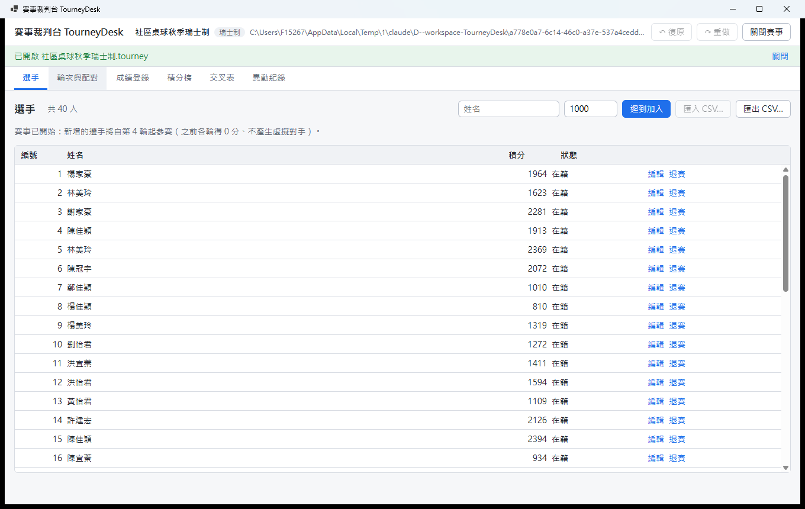
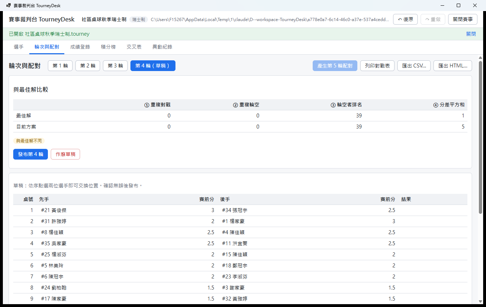
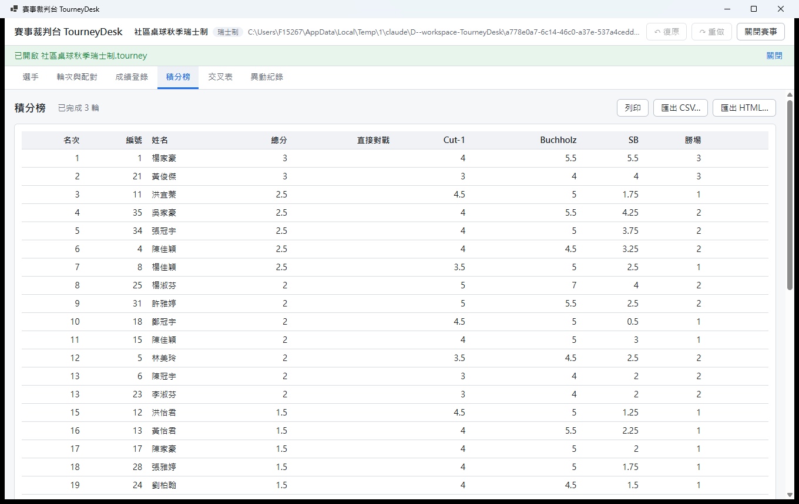
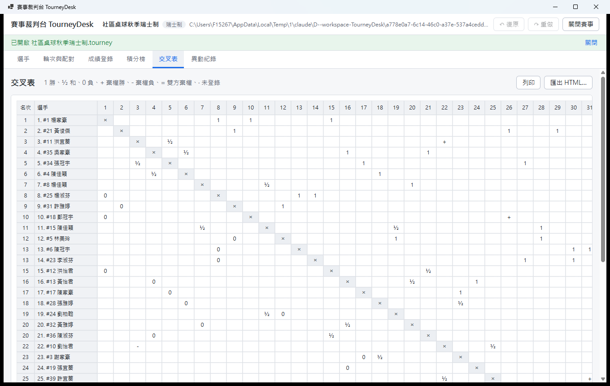
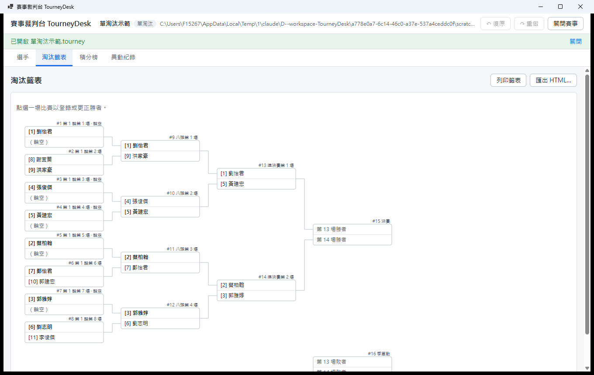
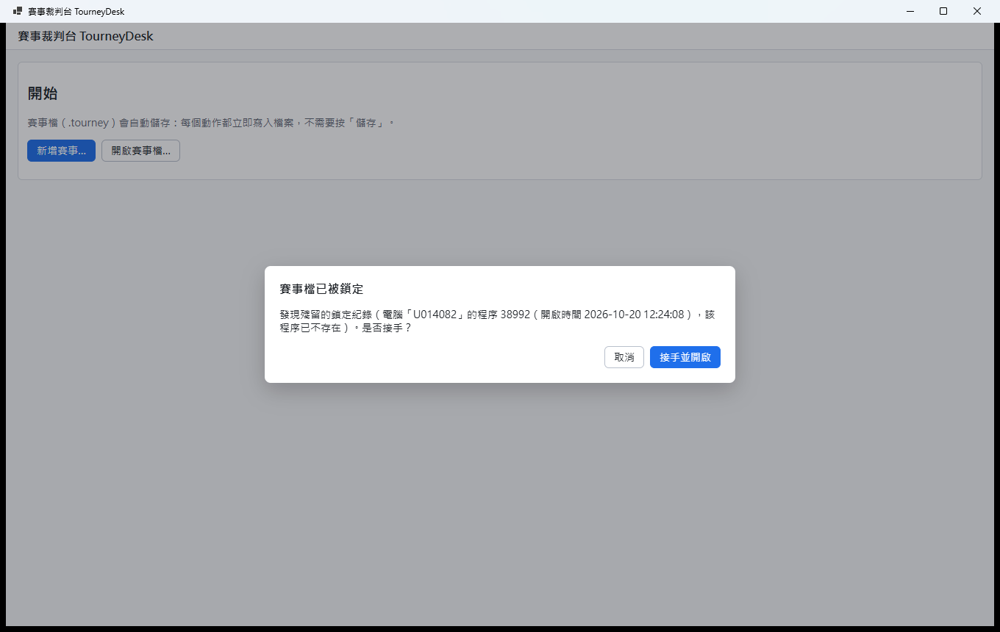

# 賽事裁判台 TourneyDesk

[](https://github.com/OWNER/TourneyDesk/actions/workflows/ci.yml)

社區桌球社的桌面賽事工具：**瑞士制、單循環、雙循環、單淘汰**的自動配對、成績登錄與更正、排名（含完整同分判定）、交叉表與淘汰籤表，並可列印貼在公佈欄的對戰表、匯出 CSV 與單檔 HTML。

> 推送到 GitHub 後，請把徽章網址中的 `OWNER` 換成實際的帳號或組織名稱。

- 每個動作都立即寫入賽事檔（單一 SQLite `.tourney` 檔），**不需要按「儲存」**。
- 100 層**復原／重做**（需求為至少 50 層），涵蓋所有操作；復原本身也寫入異動紀錄。
- 配對在背景計算，**有進度、可取消**，取消後賽事檔不會有任何變更。
- 同一個賽事檔同時只能被一個程式開啟（含網路磁碟），當機留下的殘留鎖可安全接手。

---

## 目錄

1. [截圖](#截圖)
2. [建置與執行](#建置與執行)
3. [功能](#功能)
4. [架構](#架構)
5. [演算法](#演算法)
6. [測試](#測試)
7. [效能實測](#效能實測)
8. [範例資料與工具](#範例資料與工具)
9. [設計取捨](#設計取捨)
10. [已知限制](#已知限制)

---

## 截圖

| 選手（400 人仍流暢：清單虛擬化） | 配對草稿：手動交換後即時與最佳解比較 |
|---|---|
|  |  |
| **積分榜（各項同分判定數值）** | **交叉表（SVG，依版面計算繪製）** |
|  |  |
| **淘汰籤表（SVG：輪空、季軍戰）** | **當機後的殘留鎖：確認後接手** |
|  |  |

---

## 建置與執行

需求：Windows 10/11、[.NET 9 SDK](https://dotnet.microsoft.com/download/dotnet/9.0)（9.0.x）、Microsoft Edge WebView2 Runtime（Windows 11 已內建；偵測不到時程式會顯示說明與下載網址，不會崩潰）。

```powershell
dotnet build TourneyDesk.sln
dotnet test TourneyDesk.sln                       # 全部測試（Debug；效能測試會標示為略過）
dotnet test TourneyDesk.sln -c Release            # 含效能測試
dotnet run --project src/TourneyDesk.App          # 啟動
dotnet run --project src/TourneyDesk.App -- 路徑\賽事.tourney   # 直接開啟賽事檔
```

發佈 win-x64（self-contained，使用者不需另裝 .NET）：

```powershell
dotnet publish src/TourneyDesk.App -c Release -r win-x64 --self-contained true -o publish/win-x64
```

- 賽事檔預設放在 `%UserProfile%\Documents\TourneyDesk\`；程式設定（最後使用的資料夾）放在 `%LocalAppData%\TourneyDesk\settings.json`。
- GitHub Actions（`.github/workflows/ci.yml`）會在 `windows-latest` 上建置、執行全部測試（Release，含效能測試，門檻放寬 2 倍），並上傳 `TourneyDesk-win-x64` 發佈檔為 artifact。

---

## 功能

### 賽事與選手
- 賽事：名稱、賽制、瑞士制總輪數 R（1～15）、輪空得分（0／0.5／1 分；瑞士制預設 1 分、循環賽預設 0）、單淘汰季軍戰。
- 選手：註冊編號（自動遞增、刪除後不重用）、姓名、積分（0～3000）。未排入賽程者才能刪除；已排入者可退賽。上限 500 人。
- **CSV 匯入**：自動辨識 UTF-8（含或不含 BOM）與 Big5；標題列中英文皆可、欄位順序不限，註冊編號選填（空白自動配發）。逐列驗證，錯誤列列出**行號與原因**（重複註冊編號、積分超出範圍、缺欄位、非整數…），其餘列照常匯入；整批為一個可復原的步驟。
- **退賽**：自第 k 輪起生效，第 k 輪起不再配對；第 k 輪已發布但未登錄的對局判退賽者棄權；分數凍結並保留在積分榜。循環賽固定賽程中退賽後的輪空同時取消。
- **遲到加入**（瑞士制）：自第 k 輪起參賽，之前輪次得 0 分、不產生虛擬對手。循環賽與淘汰賽開賽後不可加入。

### 瑞士制
- 依字典序目標 ①～⑤ 求**唯一最佳**配對（演算法見下）；先後手依規則決定；桌號依較高排名排列。
- **草稿**：點選兩位選手即可交換（含輪空者），畫面即時顯示目前方案與最佳解的 ①～④ 比較、是否相同，以及違規項目（重複對戰、重複輪空）。有違規時須勾選「**強制採用**」才能發布，並寫入異動紀錄（前後方案）。
- **成績更正**：已完成的輪次可直接更正。系統在背景以「現在的成績」重新計算較後輪次的引擎建議，若與**發布當時的引擎建議**不同即標示「**過期**」，並提供「**從第 k 輪起重新配對**」（清除前列出將被清除的配對與成績並要求確認，可一步復原）。系統**絕不**自行改動已發布的配對。

### 循環賽與單淘汰
- 單循環／雙循環：開賽時一次產生全部賽程；奇數人數每輪一人輪空、每人輪空次數相同；每人先後手次數差 ≤ 1；雙循環第二循環先後手互換。
- 單淘汰：依積分建立種子、標準籤位、輪空給最高種子、可加賽季軍戰；退賽者的場次由對手晉級。**更正勝者**時，所有依賴舊勝者（含季軍戰依賴的敗者）的後續場次連鎖清除——清除前列出受影響場次並要求確認，整個動作一步可復原。

### 排名、檢視與輸出
- 積分榜（顯示各項同分判定值）與交叉表，賽事進行中任何時候都能計算；淘汰賽依籤表位置排名。
- 列印（WebView2 列印介面）：對戰表（每桌一列含桌號）、積分榜、分頁籤表與分頁交叉表。
- 匯出 CSV（UTF-8 with BOM，並防範試算表公式注入）與**單檔 HTML**（樣式內嵌、不引用任何外部資源）。
- 異動紀錄：只能新增（資料庫 trigger 禁止修改／刪除），含時間、對象、前後值。

### 檔案、鎖定與復原
- 單一 `.tourney` 檔（SQLite），以 `application_id` 辨識、`user_version` 管理 schema 版本。版本過新、損毀、非本程式檔案時顯示明確訊息且**不修改檔案**；舊版先備份為 `{檔名}.v{舊版}.bak` 再升級。
- 每個動作在**單一交易**中寫入；失敗時整筆回滾，畫面狀態也不變。
- 每個輪次完成時自動保留 `{檔名}.r{N}.bak`（淘汰賽為 `.ko-r{N}.bak`）。
- 開檔鎖定：見[鎖定](#開檔鎖定)。

---

## 架構

```
TourneyDesk.sln
├─ src/
│  ├─ TourneyDesk.Core   純 net9.0：領域模型、命令、Session／復原、瑞士制引擎、blossom、
│  │                     循環賽、淘汰賽、同分判定、版面計算與分頁、鎖定邏輯、CSV、檔案層介面
│  ├─ TourneyDesk.Data   Microsoft.Data.Sqlite：賽事檔、schema 遷移、差異寫入、備份、鎖定檔
│  ├─ TourneyDesk.UI     Razor Class Library：頁面、SVG 繪製、Workspace、匯出（不引用 WinForms）
│  └─ TourneyDesk.App    WinForms + BlazorWebView 外殼：DI 組裝、檔案對話框、WebView2 列印
├─ tests/                 Core.Tests（含 Reference/ 參考解）、Data.Tests、UI.Tests（bUnit）
├─ tools/TourneyDesk.SampleGen   400 人／示範賽事產生工具
└─ samples/               範例資料、預期結果與手算說明
```

相依方向為單向：`App → UI → Core ← Data`。架構測試（`*/Architecture/DependencyRulesTests.cs`）確保 Core 不引用 Razor／WinForms／SQLite、UI 不引用 WinForms／WebView2。

### 核心設計
- **不可變狀態**：`TournamentState` 與其下的 `Player`、`Round`、`Game`、`Bracket` 都是不可變 record。排名、同分值、交叉表、過期標記等**衍生資料一律即時計算、不儲存**，所以永遠不會與成績不一致。
- **命令是純函式**：`ITournamentCommand.Apply(state, context) → Transition(新狀態, 描述, 異動紀錄)`；違規時丟出帶可讀訊息的 `DomainException`。命令不讀時鐘，現在時間由 Session 透過 `TimeProvider` 提供。
- **Session 管線**：執行、復原、重做都走同一條路——驗證 → `ITournamentStore.Commit(前, 後, 異動紀錄)`（單一交易）→ 更新記憶體狀態 → 記錄歷史。寫入失敗時狀態與歷史都不變。
- **快照式復原**：歷史存的是前後兩個不可變狀態（結構共享，成本極低），所以「復原後整個賽事的雜湊與該步之前完全相同」由構造保證，並以隨機操作序列的性質測試驗證。背景配對期間 Session 拒絕任何變更（含復原），確保計算所依據的狀態不變。
- **差異寫入**：Data 層比較前後狀態（多數子樹以參考相等快速略過），只 upsert／delete 有變動的列；只改成績時只更新那幾列。
- **分數全為整數半分**；SB 為「半分 × 半分」；所有名稱與排序以 ordinal 比較，不受地區設定影響。

### 開檔鎖定
- 鎖定檔 `{賽事檔}.lock`：持有者在整個開啟期間保留可寫 handle、只允許他人讀取。這個共用模式由作業系統強制，**SMB（網路磁碟）伺服器同樣會強制**。內容記錄電腦名稱、PID、程序啟動時間、開啟時間。
- 判定（`Core/Locking/LockArbiter`，時鐘與「程序是否仍存在」皆以介面注入）：

| 情況 | 處理 |
|---|---|
| 沒有鎖定檔 | 直接開啟 |
| handle 正被持有 | 拒絕，顯示持有者（電腦、程序、開啟時間） |
| 未被持有、本機、程序仍存在 | 拒絕 |
| 未被持有、本機、程序已不存在（PID＋啟動時間比對，防 PID 重用） | 殘留鎖，確認後接手 |
| 未被持有、他機或內容無法判讀 | 不得自動接手，須輸入「我確定要強制接手」 |

- 正常關閉時刪除鎖定檔；當機時 handle 由作業系統釋放、鎖定檔留下 → 下次開啟走殘留鎖流程（截圖即實際情境）。
- SQLite 使用 `journal_mode=DELETE`：WAL 需要共享記憶體，在網路磁碟上不可靠。

---

## 演算法

### 瑞士制配對（`Core/Swiss/SwissPairingEngine.cs`）

**問題**：本輪可配對選手依賽前排名（累計分數高→低、積分高→低、註冊編號小→大）編為 1..n。人數為奇數時加入虛擬點 D，配到 D 即輪空。求完全圖上依字典序 ①②③④⑤ 最小的完美匹配。

**① ～ ④ 可逐邊相加**，合成一個整數「主要成本」P：
- 一般邊 (a,b)：`[曾交手] × A + (分差)²`
- 輪空邊 (a,D)：`[曾輪空] × Bw + (n − 排名) × C`
- 取 `C = Σ分差²上界 + 1`、`Bw = C·n`、`A = 2·Bw`，使高位項嚴格支配所有低位項的總和。

**⑤ 的等價形式**：設兩個方案的前 t 場相同。依 hi 排序後，第 t+1 場的 hi 必然是「目前最小的未配對排名」——兩方案相同。因此 hi 永遠不會先分出勝負，⑤ 等價於**反覆讓目前排名最小的未配對者，其對手排名越大越好**。這不是逐邊可加的，但可以用分層權重**精確**編碼前 k 個最小未配對者：第 t 層（第 t 小的未配對者作為 hi）的權重為 `B^(k−1−t) × 對手位置`，B = 剩餘人數，上一層嚴格支配下一層所有可能值的總和。

**兩階段求解**（Edmonds blossom，最大權完美匹配，整數 `Int128` 權重）：
1. **第一階段**：只用 P 求解，得到最佳解與最佳對偶解。輪空者由 ③ 唯一決定，直接固定。由互補鬆弛性，**所有** P 最佳的方案只會使用「緊邊」（完整 reduced cost = 0，含 blossom 對偶），後續只需在緊邊子圖上求解。
2. **第二階段**：在緊邊子圖上，以 `(Pmax − P) × B^k + 分層權重` 求解（P 仍是最高優先，所以 blossom 的奇集合條件依然成立）；固定前 k 個未配對者作為 hi 的配對，對剩下的人重複。k 依 `Int128` 的位元預算動態決定（400 人約 8～9 層）。
3. 最佳方案在 ①～⑤ 下**唯一**（⑤ 完全決定配對、③ 決定輪空者），所以結果與輸入順序、內部 Id 無關——決定性由數學保證，並以性質測試驗證。

Blossom（`Core/Matching/MaxWeightMatching.cs`）依 Joris van Rantwijk 的 mwmatching 結構（Galil 1986 的說明）以 C# 重寫；所有權重取偶數使對偶變數全程為整數；結束時輸出緊邊集合。

**先後手**：先手次數較少者先手 → 相同時，上一場為後手者先手（只有一方上一場是後手時才分出先後）→ 仍相同時排名較高者先手。輪空不計入先手次數與「上一場」；單方或雙方棄權依排定的先後手計入。

**過期判定**：每個已發布輪次儲存發布當時的引擎建議。更正成績後，以「第 k 輪之前的現有成績＋目前參賽者」重新計算建議，與儲存值比較（含先後手）。比較的是「建議 vs 建議」，所以曾手動交換的輪次不會被誤判過期。

### 同分判定（`Core/Standings/StandingsCalculator.cs`）

依總分分組後，對每個並列群組依序比較 ② 直接對戰 → ③ Cut-1 → ④ Buchholz → ⑤ SB → ⑥ 實際勝場：
- 直接對戰只在「群組內每兩人之間都至少有一場實際對局（非棄權、非輪空）」時適用，比較群組內實際對局的得分（雙循環兩場都計）。
- 某一項把群組分成數個子群組時，每個仍並列的子群組**從 ② 重新開始**（直接對戰可能在較小群組變成適用）。
- 對手分取對手**目前**總分（退賽者為凍結分數）；自己的每個輪空或棄權場次（含棄權勝、棄權負、雙方棄權）以虛擬對手代替：`該輪前累計 + 1 半分 × max(0, 已完成輪數 − 該輪 + 1)`。遲到加入前、退賽後的未排定輪次不產生虛擬對手。
- 名次採競賽排名（1、2、2、4），並列者依註冊編號排列。

### 循環賽（`Core/RoundRobin/RoundRobinScheduler.cs`）

- **輪次（圓桌法）**：種子 S1..Sm（m 為偶數；奇數人數加入虛擬種子 Sm，配到即輪空）。第 r 輪：Sr 對 Sm；其餘 Si 與 Sj 在 `i + j ≡ 2r (mod m−1)` 時對戰。因 m−1 為奇數，2 在模 m−1 下可逆，每對種子恰好相遇一次，奇數人數時每人恰好輪空一次。
- **先後手**（與輪次分離）：對 i < j，`i + j` 為奇數時 Si 先手，否則 Sj 先手。對任一種子 k，這個規則把其餘種子平均分成先後手兩半，因此先後手差 ≤ 1（偶數場時恰好相等）。以 N = 2..64 的性質測試驗證。
- 雙循環複製第一循環並互換先後手。

### 單淘汰（`Core/Knockout`）
- 標準籤位遞迴展開：`positions(2k)` 把 `positions(k)` 的每個 s 展開為 `s, 2k+1−s`（S = 8：1v8、4v5、2v7、3v6）。種子 > N 的位置為空，其對手必為最高的 S − N 位種子 → 輪空只出現在第 1 輪且屬於最高種子。
- 每場以「來源」（種子／某場勝者／某場敗者）描述參賽者，形成 DAG；輪空與退賽 walkover 由正規化步驟依規則自動決定。更正勝者時沿 DAG 找出所有依賴的後續場次並清除。

### 版面計算（`Core/Layout`，不引用 UI）
- 籤表：整數座標；葉節點由上到下、父場次居中；連線自子場次右緣中點直角連到父場次左緣對應格。分頁時依頁高把第 1 輪切成 2 的冪次大小的子樹，逐層遞迴；每場恰好出現在一頁。
- 交叉表：列 × 欄雙向分頁，每頁帶自己的列／欄標題，每格恰好一頁。
- UI 只把版面模型轉成 `<svg>`；數值皆為整數 → SVG 輸出具決定性。

---

## 測試

```powershell
dotnet test TourneyDesk.sln -c Release
```

共 **305** 個測試案例（Core 248、Data 22、UI 35；Debug 組態下 2 個效能測試標示為略過）。

### 性質測試（固定種子；失敗時印出可重現的案例種子，`Property.Replay(seed, …)`）

| 性質 | 案例數 |
|---|---|
| 瑞士制配對與**窮舉參考解**逐案一致（N ≤ 12，含退賽、遲到加入、已輪空者、棄權；隨機限制分層數以驗證分段固定） | 600 |
| 瑞士制 ①～④ 最佳值與**位元遮罩 DP 參考解**一致（N ≤ 18） | 220 |
| 決定性：打亂輸入順序、重新指派內部 Id，配對（以註冊編號表示）完全相同 | 220 |
| 引擎結果不劣於任何隨機合法方案（N 20～60） | 60 |
| 循環賽 N = 2..64（單／雙循環所有性質） | 126 |
| 淘汰籤表 N = 2..128 種子位置與輪空 | 127 |
| 同分判定：成績登錄順序不影響積分榜 | 200 |
| 半分總和守恆 | 300 |
| 復原／重做：隨機操作序列（涵蓋全部 17 種命令），每步復原後雜湊與該步之前相同，每案例 ≥ 50 層 | 45 |
| Blossom 與暴力列舉一致，且所有最佳匹配只用緊邊 | 700 |
| 賽事檔往返無損（隨機操作＋復原，逐段重新開檔比對雜湊） | 24 |

### 參考解與正式程式碼互相獨立
`tests/TourneyDesk.Core.Tests/Reference/` 中的窮舉與 DP 參考解**直接讀取賽事原始資料**（選手、對局、輪空），自行計算賽前分數、排名、曾交手、輪空紀錄、先後手，**不呼叫正式程式碼的任何計算**（不使用 `Standings`、`Swiss`、`GameResult` 的擴充方法等），只共用資料型別。窮舉以完全不同的方法（列舉所有「輪空者 × 完美匹配」並逐一比較字典序）求解，DP 以位元遮罩求 ①～④ 最佳值。另以變異測試確認：故意把 ⑤ 的方向改錯，窮舉對照會立即失敗。

### 手算範例（逐項比對預期檔）
瑞士制第 1 輪奇偶、無法避免重複時最少、全員輪空過時最後一名輪空、先後手三種情況、瑞士制 12 人 5 輪、同分判定專用賽事、單循環 7 人、雙循環 4 人、單淘汰 11 人籤表與連鎖清除。

---

## 效能實測

測量環境：Intel Core i7-13700、32 GB RAM、Windows 11 Pro（10.0.26200）、.NET 9.0（SDK 9.0.315）、**Release** 組態，`dotnet test -c Release --filter Category=Performance`，連續兩次執行結果相近。

| 項目 | 需求 | 實測 |
|---|---|---|
| 瑞士制 400 人，每輪配對（9 輪完整賽事） | < 3 秒 | 第 1～9 輪：171、760、561、455、264、420、325、413、491 ms（**最慢 0.76 秒**） |
| 400 人、9 輪的積分榜重算 | < 200 ms | **1.4 ms** |
| （參考）瑞士制 500 人＝人數上限，每輪配對 | — | 第 1～9 輪：319、1897、2147、84、1295、1447、1040、523、1182 ms（最慢 2.1 秒） |

400 人的每一輪都驗證：每位在籍選手恰好出現一次、無重複輪空、無重複對戰。
第 1 輪全員同分，緊邊子圖為完全圖；第 2 輪起分數群組之間的退化對偶使緊邊仍很多，第二階段約需 16～21 段，為主要耗時。

Debug 組態關閉了編譯最佳化，耗時約為 Release 的 5 倍，不具代表性，因此效能測試只在 Release 執行（`ReleaseOnlyFact`）。CI 雲端 runner 較慢，以環境變數 `TOURNEYDESK_PERF_FACTOR=2` 放寬門檻。

---

## 範例資料與工具

| 路徑 | 內容 |
|---|---|
| [samples/swiss-round1](samples/swiss-round1) | 瑞士制第 1 輪 8 人／7 人手算 |
| [samples/swiss-12](samples/swiss-12) | 瑞士制 12 人 5 輪（遲到加入、兩次退賽、兩次輪空、棄權）逐輪手算與最終積分榜 |
| [samples/tiebreak](samples/tiebreak) | 同分判定專用賽事，逐項計算（直接對戰適用與不適用、分群後重新比較、虛擬對手、Cut-1、退賽對手） |
| [samples/round-robin](samples/round-robin) | 單循環 7 人、雙循環 4 人完整賽程 |
| [samples/knockout](samples/knockout) | 單淘汰 11 人籤表與一組更正勝者的連鎖清除 |

400 人測試賽事等大檔不提交到 repo，以工具產生：

```powershell
dotnet run --project tools/TourneyDesk.SampleGen -c Release -- players400 400人.tourney --rounds 9
dotnet run --project tools/TourneyDesk.SampleGen -c Release -- players400-csv 400人.csv
dotnet run --project tools/TourneyDesk.SampleGen -c Release -- demo 示範資料夾
```

---

## 設計取捨

- **快照式復原而非反向命令**：每種命令都寫反向操作容易出錯（尤其連鎖清除、重新配對）；不可變狀態加結構共享讓快照幾乎沒有成本，正確性由構造保證。代價是復原堆疊只存在記憶體，關檔即清空（異動紀錄則永久保存）。
- **衍生資料不儲存**：排名、過期等每次即時計算，犧牲少量 CPU 換取不會不一致。400 人積分榜只需約 1.4 ms。
- **過期以「建議 vs 建議」判定**：避免曾手動交換的輪次永遠被標示過期；代價是需要儲存發布當時的引擎建議。
- **⑤ 用分層權重分段求解，而非一次求解**：一次精確編碼需要約 n·log₂n 位元的權重，blossom 會慢上數十倍；分段在 `Int128` 內完成，且以緊邊子圖縮小後續求解。窮舉對照測試會隨機限制層數，確保分段邏輯正確。
- **Microsoft.Data.Sqlite 而非 EF Core**：需要精準控制交易、PRAGMA（application_id、user_version、journal_mode）與差異寫入。
- **鎖定檔＋持有 handle**：SQLite 本身的檔案鎖在網路磁碟上不可靠，也無法顯示持有者；鎖定檔讓「誰在用」與「殘留鎖」都能判斷。
- **自寫性質測試產生器而非 FsCheck**：完全控制產生的資料分布（例如刻意讓積分大量相同、加入退賽與遲到），並在失敗時印出可單獨重跑的案例種子，也少一個相依。
- **循環賽先後手與輪次分離**：圓桌法的輪次加奇偶先後手規則，簡單且可證明平衡；代價是個別選手可能連續數場同色（需求只要求次數平衡）。

## 已知限制

- 第二階段在分數群組間有大量緊邊時需要多次求解，400 人最慢約 0.76 秒；人數再增加時耗時成長很快，上限 500 人實測最慢約 2.1 秒，仍在需求的 3 秒內但餘裕較小。
- 復原歷史只存在記憶體（上限 100 層），關閉賽事後無法復原先前的操作；異動紀錄永久保存可供追查。
- 過期判定需要對較後的每一輪重新計算引擎建議；400 人、輪次很多時會在背景執行數秒（不會阻擋操作）。
- 淘汰賽雙方都退賽時由較高種子晉級（需求未定義，採最簡單的規則）。
- 單淘汰的籤表欄位名稱只對最後三輪使用「決賽／準決賽／八強」，其餘為「第 N 輪」。
- 鎖定在 SMB 上依賴伺服器端強制共用模式；少數不支援 Windows 共用模式的 NAS／Linux Samba 設定可能無法強制，此時仍會依鎖定檔內容判定，但無法阻止「同時」開啟。
- 列印版面以 A4 為準設計；籤表分頁的頁高為固定值（約 A4 橫向）。
- UI 為繁體中文，未做多語系。
