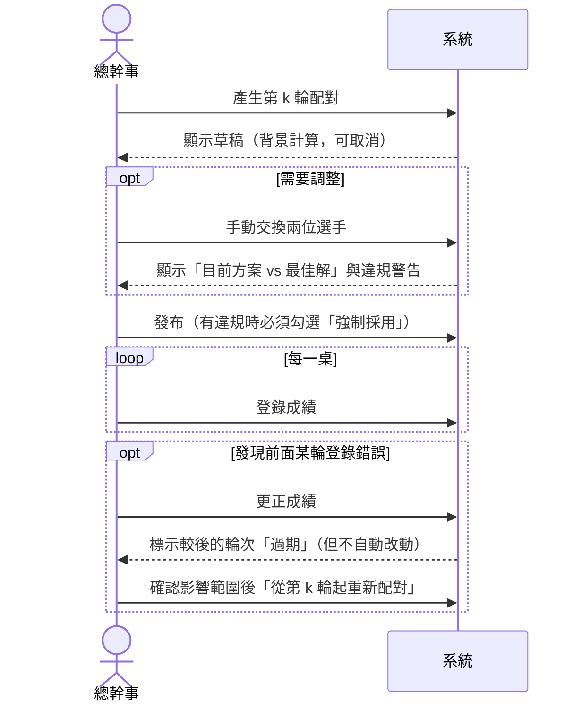

# 第 1 章　系統分析

> 本章目標：學會把一份需求文件拆解成「領域知識、使用情境、功能模組、品質要求、待決事項」，並在寫第一行程式之前，把模糊處變成明確的決策。

---

## 1.1 問題背景：裁判台在做什麼？

題目的客戶是一個四十多人的**社區桌球社**，每季辦一次循環賽與瑞士制聯賽。目前用 Excel 手動排對戰表，每輪排完都被抱怨「又碰到同一個人」「輪空怎麼老是我」。總幹事想要一個桌面工具，能自動配對、登錄成績、排出名次，並印出貼在公佈欄的對戰表。

拆開來看，操作者要做的事包括：

1. **報名**：登錄選手的姓名與積分（rating，代表實力的數字，0～3000）。
2. **排賽**：決定每一輪誰和誰對戰、誰先手、誰輪空（人數為奇數時，有一人這輪不用打）。
3. **登錄成績**：每場打完後，記下先手勝、和、後手勝或棄權。
4. **排名**：依成績算出名次；同分時用一連串「同分判定」（tie-break）分出高下。
5. **輸出**：列印對戰表、積分榜、籤表，貼在公佈欄。
6. **出錯時補救**：登錄錯了要能更正，按錯了要能復原。

TourneyDesk 就是把這些工作搬進電腦：一個 Windows 桌面程式，一場賽事存成一個 `.tourney` 檔。

> 題目中的「先手／後手」是賽制規則用語，程式裡對應 `White`／`Black`。瑞士制、Buchholz、Sonneborn-Berger 等名詞源自棋類賽事，題目沿用了這些術語；但題目也註明，它的配對目標是為了「可被窮舉驗證」而重新定義的，與棋類常用的 FIDE Dutch 系統不同。本教學中「裁判」泛指操作程式的人（也就是總幹事）。

### 題目給定的限制

題目明確規定了平台與操作方式，這些是「已知條件」，不是我們的選擇：

- **Windows 桌面程式**：WinForms 外殼加 BlazorWebView（Blazor Hybrid），不得使用 WPF、WinUI、MAUI。
- **單機單人操作**，但賽事檔**可能放在網路磁碟**；同一個檔案同時只能被一個程式開啟。
- **不得呼叫外部網路服務**（字型、腳本、圖示都必須是本機資源）、不得使用付費套件。
- 一場賽事存成**單一 SQLite 檔**，有 schema 版本管理；每個動作在單一交易中寫入，不需要按「儲存」。

這些限制影響了後面所有設計：因為沒有伺服器，檔案格式、多台電腦間的鎖定、當機回復，都要自己處理（第 6 章）。

---

## 1.2 領域知識：四種賽制

做系統分析的第一步，是先懂業務。下面是寫程式前必須弄懂的規則。

### 瑞士制（Swiss）

- 輪數比人數少很多時使用（四十多人只打幾輪；效能需求則要求 400 人、9 輪也要跑得動）。不是每個人都會互相碰到。
- 每輪開始前，依「目前分數」排名，**讓分數相近的人對戰**。
- **盡量不和同一個人再打一次**、**盡量不讓同一個人再輪空**——這正是社員對 Excel 排表的兩大抱怨。注意是「盡量」：人少輪多時可能無法避免，此時要讓違規最少（第 4 章）。
- 每輪的配對都要「依目前成績重新計算」，所以是最困難的部分。

### 單循環／雙循環（Round Robin）

- 每兩人恰好對戰一次（雙循環兩次，第二次先後手互換）。
- 開賽時就能排出全部賽程。
- 要求：每輪每人最多一場、奇數人數時每人輪空次數相同、先後手次數盡量平均。

### 單淘汰（Single Elimination）

- 輸一場就淘汰。籤表大小為 2 的冪次（8、16、32…），人數不足時由高種子輪空。
- 可以加一場「季軍戰」（兩位準決賽敗者爭第三名）。
- 更正某場勝者時，後面依賴這場結果的場次都要清除（**連鎖清除**）。

### 計分與同分判定

- 勝 1 分、和 0.5 分、負 0 分。程式裡一律用整數「半分」：**勝 2、和 1、負 0**（理由見第 3 章）。
- 同分時依序比較：直接對戰 → Buchholz Cut-1（對手分數總和去掉最低一個）→ Buchholz（對手分數總和）→ Sonneborn-Berger（SB，對手分數 × 自己對該對手的得分）→ 實際勝場數。
- 名次採「競賽排名」：兩人並列第 2，下一位就是第 4（1、2、2、4）。

> **教學重點**：不懂規則就開始寫程式，最後一定會重寫。花時間讀規則、做小例子手算，是系統分析最划算的投資。專案的 `samples/` 資料夾裡就有手算範例（例如 `samples/tiebreak/README.md` 逐項計算 9 人 4 輪的同分判定）。

---

## 1.3 使用者與使用情境

| 角色 | 主要情境 |
|---|---|
| 總幹事（操作者） | 建立賽事、匯入選手、產生配對、發布、登錄成績、處理退賽與更正、列印 |
| 其他幹部（偶爾） | 在另一台電腦開啟放在網路磁碟上的同一個檔案；系統必須拒絕並顯示「誰正在使用」 |
| 社員（間接） | 看公佈欄上的對戰表與積分榜 |

題目規定「單機單人操作」，但檔案可能放在網路磁碟，所以「另一台電腦也打開同一個檔」雖然不是正常用法，卻一定會發生，必須處理。

把情境寫成「使用案例」（use case）有助於找出隱藏需求。以瑞士制一輪為例：

從這張圖可以讀出幾個**隱藏需求**：

- 配對計算要能在背景執行、可以取消，而且取消後檔案不能有任何變化。
- 草稿與已發布是兩種狀態：草稿可以改，發布後不能再改配對。
- 更正成績**不能悄悄改掉已經發給選手的對戰表**，只能「提醒」，由裁判決定。
- 破壞性操作（清除後面的輪次）要先列出影響範圍、讓使用者確認。

---

## 1.4 把需求拆成模組

題目共有 25 條驗收標準。系統分析時，先把它們歸到模組，並評估難度：

| 模組 | 重點 | 難度 | 驗收 |
|---|---|---|---|
| 賽事／選手管理、CSV 匯入 | 編碼偵測（UTF-8／Big5）、逐列錯誤回報 | 低 | 1 |
| **瑞士制配對引擎** | 字典序最佳化、400 人 < 3 秒、可取消、要以參考解驗證 | **極高** | 2–9 |
| 循環賽排程 | 單／雙循環、輪空平均、先後手平衡 | 中 | 10–11 |
| 單淘汰籤表 | 標準種子位置、輪空、季軍戰、連鎖清除 | 中 | 12–13 |
| 成績更正與過期判定 | 不得悄悄改動已發布配對 | 高 | 14 |
| 排名／同分判定 | 遞迴分群、虛擬對手 | 高 | 15–17 |
| 檔案／鎖定／復原 | SQLite 單檔、schema 版本、網路磁碟鎖、50 層 undo | 高 | 18–20 |
| 版面計算與輸出 | 籤表與交叉表座標、分頁、SVG、列印、匯出 | 中 | 21–22 |
| 工程 | ≥ 180 個測試、≥ 7 組性質測試、CI、README | 中 | 23–25 |

**拆解後立刻看得出風險集中在哪裡**：瑞士制引擎。所以設計階段花最多篇幅在它身上（第 4 章），而且在架構上把它做成「不依賴任何 UI 與資料庫的純函式」，才能用大量自動測試驗證。

---

## 1.5 品質需求（非功能需求）

功能需求說「做什麼」，品質需求說「做到什麼程度」。這個專案的品質需求幾乎都能被測試：

| 品質需求 | 具體標準 | 架構上的對策 |
|---|---|---|
| 正確性 | 配對結果與窮舉參考解逐案一致 | 演算法放 Core、可獨立測試；另寫參考解 |
| 決定性 | 打亂輸入順序、換內部 id，結果相同 | 最佳解在數學上唯一（第 4 章證明） |
| 效能 | 400 人每輪 < 3 秒；積分榜 < 200 ms | O(n³) blossom；Release 組態效能測試 |
| 可靠性 | 每個動作立即存檔；當機不遺失資料 | SQLite 交易；不需要「儲存」按鈕 |
| 可復原 | ≥ 50 層復原，雜湊與原狀態完全相同 | 不可變狀態 + 快照式歷史 |
| 並行安全 | 兩台電腦不能同時寫同一檔 | 鎖定檔 + 作業系統共用模式 |
| 可維護 | Core 不得引用 UI／資料庫 | 架構測試在 CI 強制 |
| 數值精確 | 分數不能用浮點數 | 整數半分；反射掃描測試 |

> **教學重點**：把品質需求寫成「可以自動驗證的句子」。「要快」不能測，「400 人每輪 < 3 秒」可以測；「要可靠」不能測，「任何時間點取消，檔案與取消前逐位元組一致」可以測。

---

## 1.6 找出模糊處，變成決策

需求文件一定有沒講清楚的地方。好的做法是**在開發前列出來、提出建議、請需求方確認**，而不是自己默默猜。這個專案在 `docs/design.md` 第 14 節列出了 Q1～Q8，例如：

| # | 模糊處 | 決策 | 為什麼重要 |
|---|---|---|---|
| Q1 | 關檔後還能復原嗎？ | 不能（復原只在記憶體），但異動紀錄永久保存 | 決定 undo 要不要寫進檔案 |
| Q3 | 「過期」要跟什麼比？ | 比較「現在重算的建議」與「發布當時的建議」 | 若跟「已發布的配對」比，手動交換過的輪次會被誤判 |
| Q4 | 輪空、棄權算不算先手次數？ | 輪空不算；棄權依排定的先後手算 | 直接影響先後手演算法的輸入 |
| Q5 | 退賽後的輪次要產生虛擬對手嗎？ | 不產生 | 影響 Buchholz 的計算 |
| Q8 | 「分數不得用浮點數」要怎麼保證？ | 寫一個反射掃描測試 | 把規則變成自動檢查 |

注意 Q3：一個看似不起眼的定義問題，背後牽涉到「手動交換」與「過期判定」兩個功能的互動。這類問題如果拖到寫程式時才發現，常常要大改。

---

## 1.7 領域詞彙表

統一用詞能避免程式碼與文件互相矛盾。下表同時列出程式中的型別名稱：

| 中文 | 程式名稱 | 說明 |
|---|---|---|
| 賽事 | `TournamentState` | 一場比賽的完整狀態 |
| 選手 | `Player` | `Id`（內部）、`RegNo`（註冊編號，對外顯示）、`Rating`（積分） |
| 輪次 | `Round` | 狀態為 `Draft`（草稿）或 `Published`（已發布） |
| 對局 | `Game` | `White`（先手）、`Black`（後手）、`Result` |
| 配對方案 | `Pairing` | 不含成績的配對，用來比較與快取 |
| 引擎建議 | `Round.EngineProposal` | 發布當時引擎算出的最佳配對，過期判定的基準 |
| 籤表 | `Bracket` | 單淘汰的所有場次 |
| 命令 | `ITournamentCommand` | 任何改變狀態的操作 |
| 異動紀錄 | `AuditEntry` | 只能新增、不能修改的操作紀錄 |
| 半分 | `HalfPoints` | 勝 2、和 1、負 0 |

> **內部 Id 與註冊編號的差別**：`Id` 只用於關聯（例如對局記錄的是選手 Id），**任何排序與決定性都不得依賴它**；排序用的是 `RegNo`。這是決定性測試「重新指派內部 id 後結果相同」能通過的前提。

---

## 1.8 本章小結

1. 先懂領域規則，再做設計；用小例子手算來確認理解。
2. 用使用情境找出隱藏需求（背景計算、草稿與發布、破壞性操作要確認）。
3. 把需求歸到模組、評估難度，找出風險最高的部分。
4. 把品質需求寫成可以自動驗證的句子。
5. 把模糊處列出來、提出建議、請需求方確認，並記錄在文件裡。

下一章：有了這些分析，系統要怎麼切成專案與層次？→ [第 2 章　系統架構](02-architecture.md)
