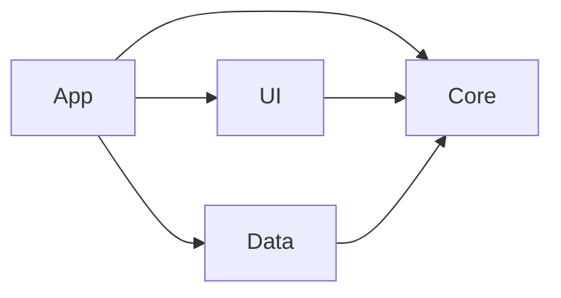
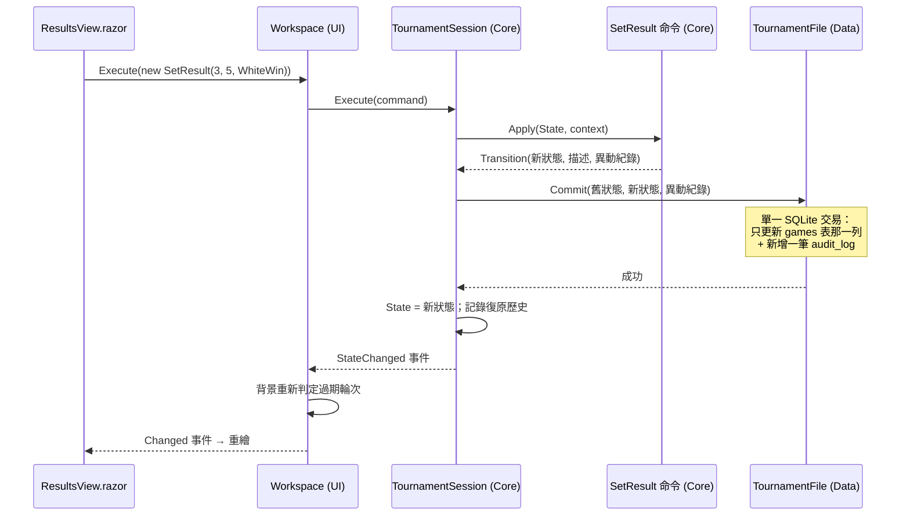

# 第 2 章　系統架構

> 本章目標：理解 TourneyDesk 為什麼切成四個專案、相依方向為什麼是單向的、一次操作的資料怎麼流動，以及如何用自動測試「守住」架構。

---

## 2.1 解決方案結構

```
TourneyDesk.sln
├─ src/
│  ├─ TourneyDesk.Core   net9.0         純邏輯：領域模型、命令、Session、所有演算法
│  ├─ TourneyDesk.Data   net9.0         SQLite 賽事檔、schema 遷移、鎖定檔
│  ├─ TourneyDesk.UI     net9.0 (RCL)   Razor 元件、Workspace、匯出（不引用 WinForms）
│  └─ TourneyDesk.App    net9.0-windows WinForms + BlazorWebView 外殼、DI 組裝
├─ tests/
│  ├─ TourneyDesk.Core.Tests   xUnit：單元、性質、參考解、效能、架構
│  ├─ TourneyDesk.Data.Tests   xUnit：真實 SQLite 檔案、鎖定
│  └─ TourneyDesk.UI.Tests     xUnit + bUnit：元件測試
├─ tools/TourneyDesk.SampleGen 產生 400 人測試賽事
└─ samples/                    範例資料、預期結果、手算說明
```

### 相依方向



**Core 不依賴任何人**；其他專案都依賴 Core。這就是常說的「依賴反轉」或「六角形架構（Hexagonal / Ports and Adapters）」：

- **Core** 定義「需要什麼」：例如 `ITournamentStore`（「我需要一個能在單一交易中寫入狀態差異的東西」）、`ILockFile`、`IProcessInspector`。
- **Data** 提供「怎麼做」：`TournamentFile` 用 SQLite 實作 `ITournamentStore`；`FileSystemLockFile` 用真實檔案實作 `ILockFile`。
- **App** 是唯一知道所有實作的地方，負責把它們組裝起來。

### 為什麼要這樣切？

| 理由 | 說明 |
|---|---|
| 可測試 | Core 不碰檔案、時鐘、UI，所以測試只要傳入資料、檢查結果。最難的瑞士制引擎可以跑上千組隨機測試，每組只要幾毫秒 |
| 可替換 | 想把 SQLite 換成別的儲存方式，只要另寫一個 `ITournamentStore` 實作，Core 一行都不用改 |
| 關注點分離 | 演算法的人不用懂 Blazor；做 UI 的人不用懂 blossom |
| 防止「順手」耦合 | 編譯器會擋住：Core 專案根本沒有引用 SQLite，寫不出 `new SqliteConnection` |

---

## 2.2 每一層的責任

### Core：規則與演算法

```
Core/
├─ Domain/      TournamentState、Player、Round、Game、Bracket、GameResult、HalfPoints
├─ Commands/    所有改變狀態的命令（AddPlayer、SetResult、PublishRound…）
├─ Session/     TournamentSession（命令管線）、UndoHistory、ITournamentStore
├─ Swiss/       配對輸入、目標函數、配對引擎、先後手、過期判定、快取
├─ Matching/    MaxWeightMatching（Edmonds blossom）
├─ RoundRobin/  圓桌法排程
├─ Knockout/    籤表建立、自動晉級規則、淘汰賽名次
├─ Standings/   ScoreSheet、同分判定
├─ Layout/      籤表與交叉表的座標計算、分頁（不引用 UI）
├─ Locking/     鎖定判定規則（純邏輯）
├─ Import/      CSV 解析、編碼偵測
└─ Hashing/     StateHasher（狀態雜湊，驗證復原）
```

注意 `Layout/` 和 `Locking/` 都放在 Core。籤表「每個方框在哪個座標」是純計算，不需要知道最後是畫成 SVG 還是印成 PDF；鎖定「何時可以接手」是純規則，不需要知道鎖定檔怎麼開。**把能抽出來的純邏輯都放進 Core，I/O 留在外圍**，是這個專案反覆使用的技巧。

### Data：把狀態存成檔案

- `TournamentFile`：建立、開啟、驗證、升級、每次轉移寫入一筆交易、自動備份。
- `StateWriter` / `StateReader`：狀態 ↔ 資料表。
- `TournamentFileInspector`：以唯讀方式檢查檔案（是不是本程式的檔、版本、完整性）。
- `Locking/`：`FileSystemLockFile`、`SystemProcessInspector`。

### UI：畫面與互動

- `Workspace`：UI 的「應用程式狀態」，包裝 `TournamentSession`，處理背景工作、過期判定、通知。
- `Pages/`：每個分頁一個 `*View.razor`。
- `Rendering/`：把 Core 的版面模型畫成 SVG、表格。
- `Services/`：`ITournamentGateway`（開檔）、`IFileDialogService`、`IPrintService` 等介面。

UI 是 Razor Class Library，**不引用 WinForms 與 WebView2**。所以 UI 元件可以用 bUnit 在測試中渲染，不需要開視窗。

### App：組裝與平台相關功能

只有約 300 行程式：`Program.Main`、`MainForm`（建立 BlazorWebView 並設定 DI）、`FileGateway`（用 Data 層實作 `ITournamentGateway`）、WinForms 檔案對話框、WebView2 列印、WebView2 執行環境檢查。

---

## 2.3 用測試守住架構

架構圖畫得再好，只要有人在 Core 裡加一行 `using Microsoft.Data.Sqlite;`，分層就破了。TourneyDesk 用**架構測試**讓 CI 自動擋下：

```csharp
// tests/TourneyDesk.Core.Tests/Architecture/DependencyRulesTests.cs
private static readonly string[] ForbiddenPrefixes =
[
    "Microsoft.AspNetCore", "System.Windows.Forms", "Microsoft.Web.WebView2",
    "Microsoft.Data.Sqlite", "TourneyDesk.Data", "TourneyDesk.UI", "TourneyDesk.App",
];

[Fact]
public void Core_does_not_reference_ui_winforms_or_data_assemblies()
{
    var core = Assembly.Load("TourneyDesk.Core");
    var offending = core.GetReferencedAssemblies()
        .Select(a => a.Name!)
        .Where(name => ForbiddenPrefixes.Any(p => name.StartsWith(p, StringComparison.Ordinal)))
        .ToList();
    Assert.Empty(offending);
}
```

UI 也有一個同樣的測試，禁止引用 WinForms 與 WebView2（`tests/TourneyDesk.UI.Tests/Architecture/DependencyRulesTests.cs`）。

> **教學重點**：架構規則如果只寫在文件裡，遲早會被打破。把它寫成測試，就變成每次 commit 都會檢查的規則。同樣的技巧也用在「分數不得用浮點數」（第 8 章）。

---

## 2.4 一次操作的資料流

以「登錄第 3 輪第 5 桌：先手勝」為例，從按下按鈕到畫面更新：



幾個關鍵點：

1. **命令不碰檔案**：`SetResult.Apply` 只是「給我舊狀態，我還你新狀態」。
2. **先寫檔、再改記憶體**：寫入失敗時，記憶體中的狀態與復原歷史都維持原樣，畫面不會顯示一個沒有存進檔案的狀態。
3. **衍生資料不儲存**：積分榜、名次、過期標記都是從狀態即時算出來的，所以不可能與成績不一致。

---

## 2.5 依賴注入（DI）的組裝

所有實作在 `MainForm` 建構子裡組裝一次：

```csharp
// src/TourneyDesk.App/MainForm.cs
var services = new ServiceCollection();
services.AddWindowsFormsBlazorWebView();
services.AddSingleton(TimeProvider.System);                      // 時鐘
services.AddSingleton<AppFolders>();
services.AddSingleton<ITournamentGateway, FileGateway>();         // 開檔（Data 層實作）
services.AddSingleton<Workspace>();
services.AddSingleton(new StartupOptions { OpenPath = startupPath });
services.AddSingleton<IFileDialogService>(sp => new WinFormsFileDialogs(this, sp.GetRequiredService<AppFolders>()));
services.AddSingleton<IPrintService>(_ => new WebViewPrintService(webView));
```

測試時則換成假實作（`tests/TourneyDesk.UI.Tests/UiTestBase.cs`）：

```csharp
Workspace = new Workspace(Gateway /* FakeGateway：狀態存在記憶體 */, TimeProvider.System);
Services.AddSingleton(Workspace);
Services.AddSingleton<IFileDialogService>(Dialogs);   // FakeDialogs
Services.AddSingleton<IPrintService>(Printer);        // FakePrinter
```

**連時鐘都是注入的**（`TimeProvider`）。命令需要「現在時間」寫異動紀錄時，由 Session 透過 `CommandContext.Now` 提供，命令本身不得呼叫 `DateTime.Now`。這讓測試可以用 `ManualTimeProvider` 控制時間，結果完全可重現。

---

## 2.6 執行緒模型

| 執行緒 | 做什麼 |
|---|---|
| UI 執行緒（WinForms／Blazor 同步內容） | 處理點擊、執行命令、寫檔、重繪 |
| 背景（`Task.Run`） | 配對計算、過期判定 |

背景計算只讀取**不可變的狀態快照**，不寫檔、不改狀態。計算完成後，結果再交回 UI 執行緒，透過命令寫入。背景配對進行中，Session 會拒絕任何變更（包括復原），確保計算所依據的狀態不會被改掉。細節見第 7 章。

---

## 2.7 技術選型

先分清楚哪些是題目指定的、哪些是自己的選擇：

**題目指定**（已知條件）：C#／.NET 9；WinForms 外殼 + BlazorWebView；Core／Data／UI／App 四個專案的切分方式；SQLite 單檔；xUnit；UI 元件測試用 bUnit；不得使用付費套件與外部網路服務。

**自己的選擇**：

| 選擇 | 理由 | 放棄的替代方案 |
|---|---|---|
| Microsoft.Data.Sqlite（直接下 SQL） | 要精準控制交易、`PRAGMA`（journal mode、application_id、user_version）與差異寫入 | EF Core（題目允許，但 ORM 在這裡反而礙事） |
| `journal_mode = DELETE` | 網路磁碟上可靠 | WAL（需要共享記憶體，在網路磁碟上不可靠） |
| 自寫 Edmonds blossom | 需要 `Int128` 整數權重與「緊邊」輸出，現成實作都不支援 | 引入外部函式庫 |
| 自寫性質測試輔助 | 30 行就夠用，能控制種子與重現方式 | FsCheck（題目允許，但多一個相依） |
| 自寫 CSV 解析 | 只需要 RFC 4180 的子集，還要逐列回報行號 | CSV 套件 |

> **教學重點**：選型時記錄「放棄了什麼、為什麼」，比記錄「選了什麼」更有價值。半年後有人問「為什麼不用 EF Core」，答案就在文件裡。

---

## 2.8 本章小結

1. Core 是中心，只有規則與演算法；I/O 與平台功能放在外圍。
2. Core 用介面描述需求，外層提供實作，App 負責組裝。
3. 架構規則寫成測試，CI 自動檢查。
4. 命令只計算、不寫檔；Session 先寫檔再更新記憶體。
5. 連時鐘都注入，讓所有測試可重現。

下一章：Core 內部的「不可變狀態 + 命令 + Session」是怎麼寫的？→ [第 3 章　領域模型與命令管線](03-domain-and-commands.md)
