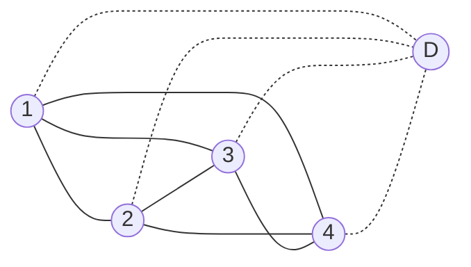
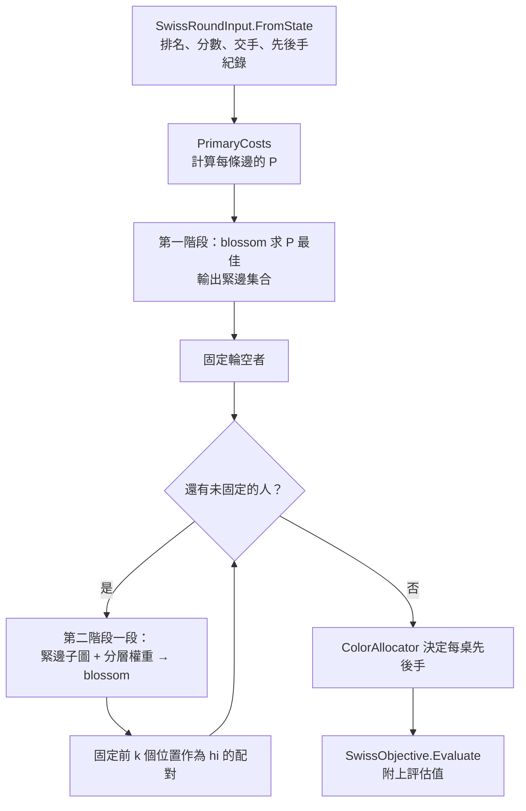

# 第 4 章　瑞士制配對演算法

> 本章目標：學會把一組帶優先順序的業務規則，轉換成圖論中的「最大權完美匹配」問題；理解 Edmonds blossom 演算法與線性規劃對偶的直覺；看懂如何用「兩階段 + 分層權重」精確求出字典序最佳解，並證明結果唯一。
>
> 這是全系統最難的一章。建議先讀 4.1～4.4 掌握建模，再讀 4.5～4.8 的演算法細節。

主要程式：

- `src/TourneyDesk.Core/Swiss/SwissRoundInput.cs`：本輪輸入（排名、分數、交手紀錄）
- `src/TourneyDesk.Core/Swiss/SwissObjective.cs`：目標值的定義與評估
- `src/TourneyDesk.Core/Swiss/SwissPairingEngine.cs`：配對引擎
- `src/TourneyDesk.Core/Matching/MaxWeightMatching.cs`：Edmonds blossom
- `src/TourneyDesk.Core/Swiss/ColorAllocator.cs`：先後手
- `src/TourneyDesk.Core/Swiss/SwissStaleness.cs`、`SwissProposalCache.cs`：過期判定與快取

---

## 4.1 規則：什麼是「最好的配對」？

每輪開始前，把可配對的選手依**賽前排名**排序：累計分數高→低、積分高→低、註冊編號小→大。排名 1 是目前最好的選手。

一個配對方案的好壞，依下列五項**字典序**比較（前一項分出高下就不看後面）：

| 順序 | 指標 | 越小越好的意思 |
|---|---|---|
| ① | 重複對戰的場數 | 盡量不要讓同一對人再下一次 |
| ② | 輪空者是否曾輪空（0 或 1） | 盡量不要讓同一人輪空兩次 |
| ③ | 輪空者的賽前排名 | **排名數字越大越好**——讓最後一名輪空 |
| ④ | 每場兩人分差的平方和 | 讓分數相近的人對戰 |
| ⑤ | 每場的 (hi, lo) 排名序列 | 細節見 4.7；直覺上是「高排名者對上排名越後面的人越好」 |

這五項在程式中是 `ObjectiveVector`，並實作 `IComparable`：

```csharp
// src/TourneyDesk.Core/Swiss/SwissObjective.cs（節錄）
public int CompareTo(ObjectiveVector? other)
{
    var c = Repeats.CompareTo(other.Repeats);                     // ①
    if (c != 0) return c;
    c = ByeRepeat.CompareTo(other.ByeRepeat);                     // ②
    if (c != 0) return c;
    c = (other.ByeRank ?? 0).CompareTo(ByeRank ?? 0);             // ③ 排名數字越大越好
    if (c != 0) return c;
    c = ScoreDiffSquares.CompareTo(other.ScoreDiffSquares);       // ④
    if (c != 0) return c;
    for (var i = 0; i < Math.Min(Pairs.Length, other.Pairs.Length); i++)   // ⑤
    {
        c = Pairs[i].Hi.CompareTo(other.Pairs[i].Hi);             // hi 小者優先
        if (c != 0) return c;
        c = other.Pairs[i].Lo.CompareTo(Pairs[i].Lo);             // hi 相同時 lo 大者優先
        if (c != 0) return c;
    }
    return Pairs.Length.CompareTo(other.Pairs.Length);
}
```

> **注意**：`SwissObjective.Evaluate` 可以評估**任何**方案（例如手動交換後的方案），引擎只是「找出評估值最小的方案」。把「評估」與「搜尋」分開，讓 UI 可以顯示「目前方案 vs 最佳解」，測試也可以拿引擎結果和窮舉結果比較評估值。

---

## 4.2 為什麼貪心法不行？

最直覺的做法：從排名 1 開始，配給「最接近且沒交手過」的人，然後換下一個未配對者。

反例：4 人同分，排名 1～4。歷史：1 和 2 交手過、2 和 4 交手過。

| 方法 | 配對 | 重複場數 |
|---|---|---|
| 貪心 | 1 跳過 2 配 3；剩下 2-4 → **重複** | 1 |
| 最佳 | 1-4、2-3 | 0 |

貪心在第一步做出看似合理的選擇，卻把後面逼進死路。要保證全域最佳，必須同時考慮所有人。人數 400 時，可能的配對方案數量是天文數字（約 399 × 397 × … × 1），也不可能窮舉。

---

## 4.3 建模：完全圖上的完美匹配

- 每位選手是一個**頂點**。
- 任兩人之間有一條**邊**，邊上有「成本」。
- 一個配對方案 = 一組邊，每個頂點恰好屬於一條邊 = **完美匹配（perfect matching）**。
- 人數為奇數時，加一個**虛擬頂點 D**，配到 D 的人就是輪空。



（上圖示意 4 人加上 D；實際上奇數人數時才加 D。）

如果能把「依 ①～⑤ 字典序最小」變成「邊權總和最大」，問題就變成教科書上的**一般圖最大權完美匹配**——有多項式時間演算法：Edmonds blossom，O(n³)。

困難在於：**字典序不是加總**。下面分兩步處理：①～④ 可以合成一個加總的權重（4.4）；⑤ 不行，要另外想辦法（4.7）。

---

## 4.4 把 ①～④ 合成一個整數成本

觀察：①～④ 都可以拆成「每條邊各自的貢獻」再相加。

- 一般邊 (a, b)：`[a、b 曾交手] × A + (a 的分數 − b 的分數)²`
- 輪空邊 (a, D)：`[a 曾輪空] × Bw + (n − 1 − a 的排名索引) × C`

方案的總成本 P = 所有邊成本的和。問題是怎麼選 A、Bw、C，讓「P 越小」等價於「①～④ 字典序越小」？

**關鍵：高位項的一單位必須嚴格大於所有低位項加起來的最大可能值。**

```csharp
// src/TourneyDesk.Core/Swiss/SwissPairingEngine.cs（PrimaryCosts 建構子）
var maxDiff = scores.Max() - scores.Min();
var maxSquaresTotal = maxDiff * maxDiff * (N / 2);   // ④ 的上界
_byeRankWeight   = maxSquaresTotal + 1;               // C  > ④ 的最大值
_byeRepeatWeight = _byeRankWeight * Math.Max(N, 1);   // Bw = C·N > ③ + ④ 的最大值
_repeatWeight    = 2 * _byeRepeatWeight;              // A  = 2·Bw > ② + ③ + ④ 的最大值
```

驗證支配關係：

| 項目 | 一單位的值 | 所有低位項的最大總和 | 支配？ |
|---|---|---|---|
| ③ 排名差一名 | C | ④ ≤ maxSquaresTotal < C | ✓ |
| ② 曾輪空 | Bw = N·C | ③ ≤ (N−1)·C，加 ④ < C → 總和 < N·C | ✓ |
| ① 一場重複 | A = 2·Bw | ② ≤ Bw（只有一條輪空邊），加 ③④ < Bw → 總和 < 2·Bw | ✓ |

③ 為什麼是 `(n − 1 − 排名索引) × C`？排名索引 0（第 1 名）成本最高，排名最後的人成本為 0——所以最小化 P 會讓排名最後的人輪空。

### 從「最小成本」到「最大權重」

Blossom 演算法求的是**最大**權。轉換方式：

```csharp
edges.Add(new WeightedEdge(a, b, 2 * (Int128)(costs.Max - costs.Pair(a, b))));
```

所有完美匹配的邊數都相同，所以「最大化 Σ(Max − cost)」等於「最小化 Σcost」。乘以 2 是為了讓權重都是**偶數**——這是 blossom 實作讓對偶變數全程維持整數的條件（4.5）。

為什麼用 `Int128`？400 人時 A、Bw、C 的乘積很容易超過 `long`。全程整數運算，沒有浮點誤差，結果可以精確比較。

---

## 4.5 Edmonds blossom：直覺說明

這一節不推導完整證明，只建立讀懂程式所需的直覺。

### 增廣路徑（augmenting path）

給定一個匹配，若有一條路徑「未配對點 → 非匹配邊 → 匹配邊 → 非匹配邊 → … → 未配對點」，把路徑上的邊「匹配 ↔ 非匹配」互換，匹配就多一條邊。反覆找增廣路徑，直到找不到，就是最大匹配。

在二分圖（例如「工人 ↔ 工作」）上，用 BFS 就能找增廣路徑。

### 奇環的麻煩與 blossom

一般圖（不是二分圖）有**奇數長度的環**。BFS 交替標記頂點時，奇環會讓同一個頂點同時被標成「偶數距離」和「奇數距離」，搜尋就亂掉了。

Edmonds 在 1965 年的關鍵想法：**把奇環縮成一個超級頂點（blossom，花）**，在縮小後的圖上繼續找；找到增廣路徑後再把花展開，花內部一定能重新配好。花可以巢狀（花中有花）。

### 加權版本：Primal-Dual

最大**權**匹配還要考慮權重。演算法同時維護：

- **Primal**：目前的匹配。
- **Dual**：每個頂點一個對偶變數 u(v)，每個 blossom 一個對偶變數 z(B)。

並保持對每條邊 (i, j)：

```
slack(i, j) = u(i) + u(j) − 2·w(i, j) + 2·Σ z(B)  ≥ 0     （B 為同時包含 i、j 的 blossom）
```

只有 slack = 0 的邊（**緊邊，tight edge**）能用來擴展搜尋。找不到增廣路徑時，就調整對偶變數（讓某些邊變緊），再繼續。結束時，匹配是最佳的，對偶解也是最佳的。

程式中的對應：

```csharp
// src/TourneyDesk.Core/Matching/MaxWeightMatching.cs
private Int128 Slack(int k)
{
    var e = _edges[k];
    return _dualvar[e.U] + _dualvar[e.V] - 2 * e.Weight;   // 未含 blossom 項；完整 slack 見 TightEdges()
}
```

這份實作依 Joris van Rantwijk 的 mwmatching（Galil 1986 的說明）結構，以 C# 重寫，權重改為 `Int128`。對偶變數的調整量會出現「除以 2」，所以要求所有權重是偶數，保證全程是整數。

> **教學重點**：這種經典演算法自己從零發明很容易出錯。正確的做法是找一份公認可靠的參考實作，忠實移植，再用大量測試（與暴力解比對）驗證。專案中 `MaxWeightMatchingTests` 用 700 組隨機圖與暴力搜尋比對。

---

## 4.6 對偶與緊邊：為什麼可以縮小問題

線性規劃的**互補鬆弛性（complementary slackness）**告訴我們：給定一組最佳對偶解，**任何**最佳的匹配都只會使用 slack = 0 的邊。

所以第一階段用 P 求出最佳解後，可以順便輸出「緊邊集合」（完整 slack，含 blossom 對偶項）：

```csharp
// src/TourneyDesk.Core/Matching/MaxWeightMatching.cs
/// <summary>完整 slack = dual(i) + dual(j) − 2w + 2 Σ z(B)（B 為同時包含 i、j 的 blossom）。</summary>
private bool[] TightEdges()
{
    // 對每條邊，沿著 blossom 樹往上找 i、j 共同所在的 blossom，加上 2·z(B)
    // ...
    tight[k] = s == 0;
}
```

這帶來兩個好處：

1. **輪空者直接確定**：③ 讓不同的輪空者有不同的 P，所以所有 P 最佳的方案輪空者都相同，直接固定。
2. **後續只在緊邊子圖上算**：所有「①～④ 都最佳」的方案，必然只用緊邊。緊邊通常遠少於全部的邊，第二階段更快。

一個細節：只限制在緊邊上，還不足以保證是 P 最佳（blossom 還有「奇集合」條件）。所以第二階段**仍把 P 放在最高優先**——這樣在緊邊子圖上找到的最佳解，一定也是全域 P 最佳。緊邊只是「剪枝」，正確性由 P 的優先權保證。

---

## 4.7 處理 ⑤：分層權重

### ⑤ 的等價形式

⑤ 比較的是「依 hi 排序的 (hi, lo) 序列」：hi 小者優先，hi 相同時 lo 大者優先。

設兩個方案的前 t 場相同。第 t+1 場的 hi 是什麼？——一定是「**目前最小的未配對排名**」，因為比它小的都已經配掉了，而它自己一定是某一場的 hi。兩個方案的這個值相同，所以 hi 永遠不會先分出勝負。

因此 ⑤ 等價於：**反覆讓目前排名最小的未配對者，選排名越大（越後面）的對手越好。**

這不能拆成「每條邊各自的貢獻」，因為「誰是目前最小的未配對者」取決於前面怎麼配。

### 分層權重

想法：對**前 k 個**最小的未配對者，給「位置越前面的 hi」越高的權重級數，讓上一層嚴格支配下一層。

設剩餘 m 人，依排名編位置 0..m−1，取基數 B = m。邊 (pa, pb)（pa < pb）的 ⑤ 權重：

```
lex(pa, pb) = B^(k−1−pa) × pb     若 pa < k
            = 0                    否則
```

```csharp
// src/TourneyDesk.Core/Swiss/SwissPairingEngine.cs（SolveLayered 節錄）
var levelWeight = new Int128[layers];
levelWeight[layers - 1] = 1;
for (var t = layers - 2; t >= 0; t--)
    levelWeight[t] = levelWeight[t + 1] * bas;           // B^(k−1−t)

foreach (var (pa, pb, cost) in tightPairs)
{
    var lex = pa < layers ? levelWeight[pa] * pb : 0;
    var w = ((Int128)(maxCost - cost) * scale) + lex;    // P 仍在最高位
    edges.Add(new WeightedEdge(pa, pb, 2 * w));
}
```

**支配性**：第 t 層每多一單位（對手位置 +1）增加 B^(k−1−t)；所有更低層加起來最多是

```
Σ_{s>t} B^(k−1−s) × (m−1) = (m−1) × (B^(k−1−t) − 1)/(B − 1) < B^(k−1−t)     （B = m）
```

所以上一層嚴格支配下一層。而 `scale = B^k` 大於所有 lex 的總和，P 又嚴格支配整個 ⑤。

### 手算範例

4 人同分、沒有交手紀錄 → P 全部相同，只看 ⑤。m = 4，B = 4，k = 4，層權重 64、16、4、1（位置 0～3）。

| 方案 | 各邊 lex | 總和 |
|---|---|---|
| 1-2、3-4 | 64×1 + 4×3 = 76 | 76 |
| 1-3、2-4 | 64×2 + 16×3 = 176 | 176 |
| **1-4、2-3** | 64×3 + 16×2 = 224 | **224 ← 最大** |

結果：第 1 名對第 4 名、第 2 名對第 3 名——正是 ⑤ 要的「高排名者的對手越後面越好」。

### 位元預算與分段固定

權重不能無限大：`Int128` 最大約 2^127，演算法中對偶變數還需要餘裕。程式把單邊權重限制在 2^100 以內，能放幾層就放幾層：

```csharp
var primarySpan = (Int128)(maxCost - minCost) + 1;   // 只需涵蓋「剩餘緊邊之間」的成本範圍
var layers = 0;
Int128 scale = 1;
while (layers < m && 2 * primarySpan * scale * bas < limit)
{
    scale *= bas;
    layers++;
}
```

人很多時一次放不下所有層。解法是**分段固定**：

1. 用 k 層求解，固定前 k 個位置作為 hi 的配對。
2. 從剩餘名單移除這些人，重新計算 m、B、k。
3. 重複直到全部固定。

每一段都以 P 為最高優先，所以固定下來的配對一定屬於某個全域最佳解；剩下的問題又是同一種子問題。

`primarySpan` 只取剩餘緊邊之間的成本差（而不是全部邊），是一個效能優化：緊邊之間的成本差通常很小，省下的位元可以多放幾層，減少分段次數。這個改動讓 500 人的最慢一輪從約 2.3 秒降到約 2.0 秒。

---

## 4.8 完整流程



對應的主程式：

```csharp
// src/TourneyDesk.Core/Swiss/SwissPairingEngine.cs（Pair 節錄）
var (tight, bye) = SolvePrimary(costs, cancellationToken);           // 第一階段
var remaining = Enumerable.Range(0, n).Where(i => i != bye).ToList();
while (remaining.Count > 0)
{
    cancellationToken.ThrowIfCancellationRequested();
    var newlyFixed = SolveLayered(costs, tight, remaining, maxLayers, cancellationToken);  // 第二階段一段
    foreach (var (hi, lo) in newlyFixed) { mate[hi] = lo; mate[lo] = hi; }
    remaining.RemoveAll(done.Contains);
    progress?.Report(Percent(fixedCount, n));                        // 進度依已固定人數，單調遞增
}
// 先後手
for (var i = 0; i < n; i++)
    if (mate[i] > i)
        games.Add(ColorAllocator.Assign(input, input.Ranked[i].Id, input.Ranked[mate[i]].Id));
```

---

## 4.9 唯一性與決定性

需求：打亂輸入順序、重新指派內部 Id，結果（以註冊編號表示）必須相同。

很多實作會靠「穩定排序」或「固定迭代順序」來達成，但那很脆弱。TourneyDesk 的保證來自數學：

- ③ 讓輪空者唯一（不同人排名不同）。
- ⑤ 在「目前最小的未配對者」上逐步決定對手，每一步的最大值唯一（不同對手位置不同），所以**整個配對唯一**。
- 排名本身只依分數、積分、註冊編號決定，與內部 Id 和輸入順序無關。

**最佳解在 ①～⑤ 下唯一 → 任何正確的演算法都會得到同一個答案**。決定性是正確性的推論，而不是另外的實作細節。性質測試再以 220 組隨機案例驗證。

---

## 4.10 先後手

配對確定後，再決定每桌誰先手：

```csharp
// src/TourneyDesk.Core/Swiss/ColorAllocator.cs
public static PairedGame Assign(SwissRoundInput input, int idA, int idB)
{
    var a = input.Get(idA);
    var b = input.Get(idB);
    if (a.WhiteCount != b.WhiteCount)                                   // 1. 先手次數較少者先手
        return a.WhiteCount < b.WhiteCount ? new PairedGame(idA, idB) : new PairedGame(idB, idA);

    var aLastBlack = a.LastColor == PieceColor.Black;                   // 2. 上一場為後手者先手
    var bLastBlack = b.LastColor == PieceColor.Black;
    if (aLastBlack != bLastBlack)
        return aLastBlack ? new PairedGame(idA, idB) : new PairedGame(idB, idA);

    return input.RankOf[idA] < input.RankOf[idB]                        // 3. 排名較高者先手
        ? new PairedGame(idA, idB) : new PairedGame(idB, idA);
}
```

輸入中的 `WhiteCount`、`LastColor` 依決策 Q4 計算：輪空不計；棄權依排定的先後手計入（`SwissRoundInput.FromState`）。

先後手不放進匹配的權重裡，是刻意的分離：需求的優先順序是「先決定誰對誰，再決定顏色」，分開處理讓兩部分都更簡單、更好測試。

---

## 4.11 取消與進度

- **進度**：以「已固定的人數 / 總人數」回報，固定是單調的，所以進度單調遞增。
- **取消**：在每一段開始前、blossom 每個 stage 開始前檢查 `CancellationToken`。

```csharp
progress?.Report(Percent(fixedCount, n));
// ...
cancellationToken.ThrowIfCancellationRequested(); // 回報完成前取消，一律不交出結果
progress?.Report(100);
```

引擎本身不改任何狀態，取消只是丟出 `OperationCanceledException`。測試 `Cancellation_at_any_progress_point_throws_without_result` 在**每個進度點**各取消一次；Data 層的測試再確認取消後賽事檔與取消前逐位元組相同。

---

## 4.12 過期判定

### 問題

裁判更正了第 3 輪的一個成績。第 4、5 輪的配對是依「舊成績」排的，現在還是最佳的嗎？需求規定：**系統不能自行改動已發布的配對**，只能標示「過期」，由裁判決定要不要「從第 k 輪起重新配對」。

### 比較什麼？

決策 Q3：比較「**現在重算的引擎建議**」與「**發布當時的引擎建議**」（`Round.EngineProposal`），而不是與「已發布的配對」比。

為什麼？如果裁判在第 4 輪手動交換過兩人，已發布配對本來就和引擎建議不同。和已發布配對比，第 4 輪會永遠被判為過期——這是誤報。和「發布當時的建議」比，只有在**輸入真的改變**時才會判為過期。

```csharp
// src/TourneyDesk.Core/Swiss/SwissStaleness.cs（節錄）
foreach (var round in candidates)    // 已發布、有引擎建議的瑞士制輪次
{
    var input = SwissRoundInput.FromState(AsAtPublication(state, round), round.Number);
    if (!SameParticipants(input, round.EngineProposal!) ||
        !Propose(input, cache, cancellationToken).SameAs(round.EngineProposal!))
    {
        stale.Add(round.Number);
    }
}
```

### 退賽不是更正

選手在第 4 輪發布後退賽，第 4 輪他的對局會判棄權。如果直接用「目前的參賽者」重算第 4 輪，他已經不在名單上，建議當然不同——第 4 輪被誤判為過期（這是外部審查發現的 bug，見第 10 章）。

修正：判定第 k 輪時，「出現在該輪引擎建議中、但退賽生效輪 ≤ k」的選手，暫時視為仍在籍：

```csharp
private static TournamentState AsAtPublication(TournamentState state, Round round)
{
    var adjusted = state;
    foreach (var id in Participants(round.EngineProposal!))
        if (state.Players.TryGetValue(id, out var p) && p.WithdrawRound is { } w && w <= round.Number)
            adjusted = adjusted.WithPlayer(p with { WithdrawRound = round.Number + 1 });
    return adjusted;
}
```

### 快取：只重算輸入有變的輪次

每次狀態改變都要重算所有已發布輪次的建議。400 人 9 輪時，全部重算約 4.9 秒，CPU 一直滿載。

觀察：**引擎是輸入的純函式**。只要第 k 輪的輸入沒變，建議就一定沒變。所以可以用「輸入指紋」當快取鍵：

```csharp
// src/TourneyDesk.Core/Swiss/SwissRoundInput.cs
/// 輸入指紋：涵蓋引擎用到的全部資訊（依排名的選手及其分數、積分、輪空紀錄、先後手狀態，
/// 以及參賽者之間的交手紀錄）。引擎結果完全由輸入決定，因此可作為快取鍵。
public string Fingerprint => _fingerprint ??= ComputeFingerprint();
```

```csharp
// src/TourneyDesk.Core/Swiss/SwissProposalCache.cs
public Pairing GetOrCompute(SwissRoundInput input, CancellationToken cancellationToken)
{
    if (_entries.TryGetValue(input.Fingerprint, out var cached))
    {
        Interlocked.Increment(ref _hits);
        return cached;
    }
    var pairing = SwissPairingEngine.Pair(input, null, cancellationToken).Pairing;
    Interlocked.Increment(ref _misses);
    if (_entries.Count >= capacity)
        _entries.Clear();            // 簡單的上限策略：滿了就全清（每場賽事至多 15 輪，足夠）
    _entries[input.Fingerprint] = pairing;
    return pairing;
}
```

效果（400 人 9 輪）：

| 情境 | 重算輪數 | 耗時 |
|---|---|---|
| 第一次（冷快取） | 全部 | 約 4.5 秒 |
| 登錄最後一輪的成績 | 0（最後一輪的成績不影響任何已發布輪次的輸入） | 約 8 ms |
| 更正第 5 輪的成績 | 第 6～9 輪 | 約 1.7 秒 |

> **教學重點**：純函式的最大紅利之一就是可以安全地快取。快取正確的前提是「指紋涵蓋所有會影響結果的輸入」——漏掉一項就會回傳錯誤的舊結果。所以快取測試裡有一個性質測試：隨機更正成績後，「有快取」與「無快取」的判定結果必須完全相同。

---

## 4.13 複雜度與效能

| 步驟 | 複雜度 |
|---|---|
| 建立成本（完全圖） | O(n²) |
| 第一階段 blossom | O(n³) |
| 第二階段：每段一次 blossom（緊邊子圖，通常小得多） | 段數 × O(m³) |
| 先後手 | O(n) |

實測（Release，i7-13700）：400 人 9 輪，每輪最慢 0.72 秒（需求上限 3 秒）；500 人最慢約 2 秒。

---

## 4.14 如何確定它是對的？

演算法這麼複雜，「看起來對」是不夠的。專案用三種**彼此獨立**的方式驗證（細節見第 8 章）：

| 驗證 | 規模 | 比對內容 |
|---|---|---|
| 窮舉參考解（`Reference/BruteForceSwissPairing.cs`） | N ≤ 12，600 組隨機歷史 | 完整配對，含先後手 |
| 位元遮罩 DP 參考解（`Reference/BitmaskDpSwissPairing.cs`） | N ≤ 18，220 組 | ①～④ 的最佳值 |
| 決定性 | N ≤ 40，220 組 | 打亂順序、換 Id 後結果相同 |
| 不劣於隨機方案 | N 20～60，60 組 | 引擎結果 ≤ 任何隨機合法方案 |

參考解**不呼叫任何 Core 演算法**，只引用輸入資料型別，避免「用同一份錯誤的程式驗證自己」。

另外有一個「變異測試」：故意把 ⑤ 的方向寫反，確認窮舉比對會失敗——證明測試真的有能力抓到這類錯誤。

---

## 4.15 本章小結

1. 先把規則定義成可比較的目標值（`ObjectiveVector`），再談怎麼找最佳解。
2. 貪心不行；建模成完全圖上的最大權完美匹配，用 Edmonds blossom 求解。
3. 可逐邊相加的優先項，用「高位支配低位總和」的權重合成一個整數。
4. 對偶解的緊邊可以安全地縮小後續問題；P 保持最高優先保證正確。
5. 不可加總的 ⑤，用分層權重精確編碼，位元不夠時分段固定。
6. 最佳解唯一 → 決定性是正確性的推論。
7. 純函式可以用輸入指紋精確快取。
8. 用獨立的參考解與性質測試驗證，而不是只看幾個例子。

下一章：循環賽、淘汰賽與同分判定。→ [第 5 章](05-round-robin-knockout-standings.md)
