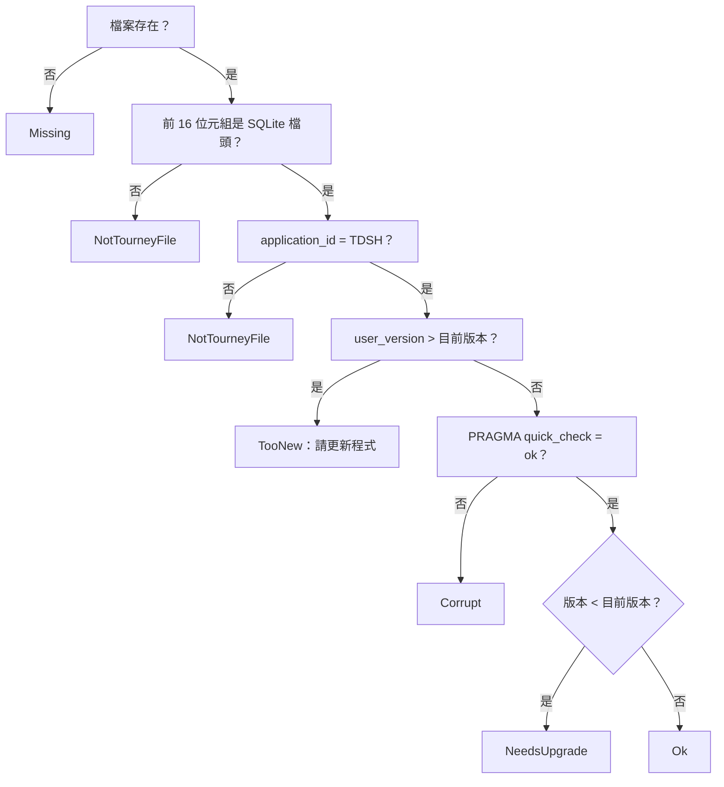

# 第 6 章　資料層與檔案鎖定

> 本章目標：學會用 SQLite 把一個不可變的領域狀態可靠地存成單一檔案——每個動作立即寫入、寫到一半當機也不壞、舊版檔案可升級；以及在沒有伺服器的情況下，讓多台電腦安全地共用同一個檔案。

主要程式：`src/TourneyDesk.Data/`、`src/TourneyDesk.Core/Locking/`

---

## 6.1 需求回顧

| 需求 | 對策 |
|---|---|
| 不需要「儲存」按鈕，每個動作立刻存檔 | 每次狀態轉移一筆 SQLite 交易 |
| 寫到一半當機或斷電，檔案不能壞 | SQLite 的 rollback journal（`journal_mode = DELETE`）＋ `synchronous = FULL` |
| 能辨認「這是不是本程式的檔」 | `PRAGMA application_id` |
| 新版程式能開舊版檔案；舊版程式開新版檔案時要明確拒絕 | `PRAGMA user_version` + 遷移 |
| 檔案可能放在網路磁碟 | 不用 WAL；鎖定靠作業系統的檔案共用模式 |
| 異動紀錄不能被竄改 | 資料表 trigger 禁止 UPDATE 與 DELETE |
| 每輪結束自動備份 | SQLite 線上備份 API |

---

## 6.2 Schema 設計

```sql
-- src/TourneyDesk.Data/Schema.cs（節錄）
CREATE TABLE settings (id INTEGER PRIMARY KEY CHECK (id = 1), name TEXT NOT NULL, ...);
CREATE TABLE players  (id INTEGER PRIMARY KEY, reg_no INTEGER NOT NULL UNIQUE, name TEXT NOT NULL,
                       rating INTEGER NOT NULL CHECK (rating BETWEEN 0 AND 3000), join_round INTEGER, withdraw_round INTEGER);
CREATE TABLE rounds   (number INTEGER PRIMARY KEY, status INTEGER NOT NULL, bye INTEGER, ...);
CREATE TABLE games    (round INTEGER NOT NULL, board INTEGER NOT NULL, white INTEGER NOT NULL,
                       black INTEGER NOT NULL, result INTEGER NOT NULL, PRIMARY KEY (round, board));
CREATE TABLE proposal_games (...);   -- 發布當時的引擎建議（過期判定用）
CREATE TABLE bracket (...); CREATE TABLE bracket_seeds (...); CREATE TABLE bracket_matches (...);
CREATE TABLE audit_log (seq INTEGER PRIMARY KEY AUTOINCREMENT, timestamp TEXT NOT NULL,
                        kind TEXT NOT NULL, target TEXT NOT NULL, before TEXT, after TEXT);
```

設計要點：

- **單列表**用 `CHECK (id = 1)` 保證只有一列（`settings`、`bracket`）。
- **資料庫層也做驗證**（`CHECK (rating BETWEEN 0 AND 3000)`、`UNIQUE`）。領域層已經驗證過，這是第二道防線：就算程式有 bug，也不會寫進違規資料。
- **列舉存整數**，不存字串，避免改顯示文字時壞掉舊檔。
- **衍生資料不存**：沒有「名次」「分數」欄位，與第 3 章的原則一致。

### 只能新增的異動紀錄

```sql
CREATE TRIGGER audit_log_no_update BEFORE UPDATE ON audit_log
BEGIN SELECT RAISE(ABORT, 'audit_log 只能新增'); END;
CREATE TRIGGER audit_log_no_delete BEFORE DELETE ON audit_log
BEGIN SELECT RAISE(ABORT, 'audit_log 只能新增'); END;
```

把「只能新增」做在資料庫裡，而不是只靠程式自律。即使未來有人寫錯程式想刪紀錄，資料庫也會拒絕。

---

## 6.3 檔案辨識與版本

```csharp
// src/TourneyDesk.Data/Schema.cs
public const int ApplicationId = 0x54445348;   // 'TDSH'
public const int CurrentVersion = 2;
public static readonly string[] Migrations = [V1ToV2];   // 索引 i：第 i+1 版 → 第 i+2 版
```

SQLite 檔頭有兩個整數欄位可以自由使用：

- `application_id`：寫入 `'TDSH'` 的 ASCII 碼。別的程式的 SQLite 檔，這個值不同，開啟時就能明確說「這是 SQLite 檔案，但不是 TourneyDesk 賽事檔」。
- `user_version`：schema 版本。

### 開檔前先唯讀檢查

`TournamentFileInspector.Inspect` 以**唯讀**連線檢查，**絕不修改檔案**：



每種結果都有一句使用者看得懂的訊息。測試會比對檢查前後檔案的 SHA-256，確保「版本過新、損毀、非本程式檔案」時檔案一個位元組都沒變。

### 遷移：先備份再升級

```csharp
private static void Upgrade(string path, int fromVersion, TimeProvider time)
{
    var backup = $"{path}.v{fromVersion}.bak";
    if (File.Exists(backup))
        backup = $"{path}.v{fromVersion}.{time.GetLocalNow():yyyyMMddHHmmss}.bak";   // 注入的時鐘
    File.Copy(path, backup);
    using var tx = connection.BeginTransaction();
    for (var v = fromVersion; v < Schema.CurrentVersion; v++)
        StateWriter.Exec(connection, tx, Schema.Migrations[v - 1]);
    StateWriter.Exec(connection, tx, $"PRAGMA user_version = {Schema.CurrentVersion}");
    tx.Commit();
}
```

重點：

- 升級前先備份，備份失敗就不升級。
- 所有遷移與版本號更新在**同一個交易**裡：要嘛全部完成，要嘛完全沒做。
- 新建檔案時也依序跑遷移（`Create` 中的迴圈），保證「新建的檔」與「升級上來的檔」schema 完全相同。

---

## 6.4 差異寫入

Session 每次呼叫 `Commit(before, after, audit)`。最簡單的做法是「刪掉全部再重寫」，但 400 人的賽事每登錄一個成績就重寫上千列，太浪費。

`StateWriter` 比較前後狀態，只寫有變的部分。關鍵技巧是**不可變物件的參考相等**：

```csharp
// src/TourneyDesk.Data/StateWriter.cs（節錄）
private static void WritePlayers(..., TournamentState? before, TournamentState after)
{
    if (before is not null && ReferenceEquals(before.Players, after.Players))
        return;                                // 選手集合是同一個物件 → 完全沒變，O(1) 跳過
    // 刪除消失的、upsert 有變的
}

private static void WriteRounds(...)
{
    for (var n = 1; n <= max; n++)
    {
        if (ReferenceEquals(old, now)) continue;           // 這一輪沒變
        if (now is null) DeleteRound(c, tx, n);
        else if (old is not null && OnlyResultsDiffer(old, now))
            // 只改成績 → 只 UPDATE games 那幾列
        else
            // 配對變了 → 整輪刪除重寫
    }
}
```

因為命令用 `with` 產生新狀態，沒被改到的子樹**就是同一個物件**。`ReferenceEquals` 是 O(1)，比逐欄比較快得多。登錄一個成績時，實際只執行一句 `UPDATE games SET result = ...` 加一句 `INSERT INTO audit_log`。

### 一個踩過的坑：INSERT OR REPLACE

選手表原本用 `INSERT OR REPLACE`。SQLite 的 `REPLACE` 遇到**任何** `UNIQUE` 衝突（不只主鍵）時，會**默默刪除衝突的那一列**再插入——寫入的選手若與另一位選手的註冊編號衝突，另一位選手就整列消失，而且不會報錯。改成：

```sql
INSERT INTO players (...) VALUES (...)
ON CONFLICT (id) DO UPDATE SET reg_no = excluded.reg_no, name = excluded.name, ...
```

只在主鍵衝突時更新，註冊編號的 `UNIQUE` 衝突則照常報錯、整筆交易回滾。這個 bug 是由「交易回滾」測試抓到的：故意製造註冊編號衝突，預期整筆交易失敗、檔案內容不變，結果發現另一位選手被刪除了。

---

## 6.5 交易與耐久性

```csharp
// src/TourneyDesk.Data/TournamentFile.cs
public void Commit(TournamentState before, TournamentState after, IReadOnlyList<AuditEntry> audit)
{
    using var tx = _connection.BeginTransaction();
    StateWriter.Write(_connection, tx, before, after);
    foreach (var a in audit)
        StateWriter.Exec(_connection, tx, "INSERT INTO audit_log (...) VALUES (...)", ...);
    tx.Commit();
    // 交易成功後：剛完成的輪次自動備份
    foreach (var label in CompletedRounds.NewlyCompleted(before, after))
        Backup(label);
}
```

連線設定：

```csharp
var builder = new SqliteConnectionStringBuilder { DataSource = path, Mode = mode, Pooling = false };
// ...
StateWriter.Exec(connection, null, "PRAGMA journal_mode = DELETE");   // 不用 WAL
StateWriter.Exec(connection, null, "PRAGMA synchronous = FULL");
```

| 設定 | 理由 |
|---|---|
| `Pooling = false` | 關閉檔案時立即釋放 handle，鎖定、備份、刪除檔案都需要 |
| `journal_mode = DELETE` | WAL 模式需要共享記憶體（`-shm` 檔），在網路磁碟上不可靠 |
| `synchronous = FULL` | 每次交易確實寫到磁碟才回報成功 |

### 自動備份

每當某一輪「剛完成」（所有對局都有結果），就用 SQLite 的線上備份 API 產生 `{檔名}.r{N}.bak`（淘汰賽為 `.ko-r{N}.bak`）。線上備份會產生一致的快照，不會備份到寫了一半的狀態。

備份失敗**不影響主要寫入**（主要寫入已經成功），只發出警告事件，UI 顯示錯誤通知。這是「在適當的層級處理錯誤」的例子：備份是附加功能，不能因為它失敗就讓整個操作失敗。

---

## 6.6 當機回復：熱日誌

### SQLite 的 rollback journal 怎麼運作

`journal_mode = DELETE` 時，交易修改資料頁之前，會先把**原本的內容**寫進 `{檔名}-journal`。交易成功後刪除日誌。如果交易進行到一半當機，主檔可能已經被改了一部分，但日誌還在——這叫**熱日誌（hot journal）**。下一個連線開檔時，SQLite 會用日誌把主檔還原到交易前的狀態。

### 外部審查發現的 bug

開檔流程是「先用唯讀連線檢查，通過才用讀寫連線開啟」。問題是：**唯讀連線無法用熱日誌回復**（回復需要寫入主檔）。SQLite 會回傳 `SQLITE_READONLY_ROLLBACK`（延伸碼 776，基本碼 8），原本的程式把它歸類為「損毀」，使用者就打不開檔案了——即使資料其實完好。

修正：

```csharp
// src/TourneyDesk.Data/TournamentFileInspector.cs
catch (SqliteException ex) when (ex.SqliteErrorCode == SqliteReadOnly && File.Exists(path + "-journal"))
{
    // 唯讀連線無法回復「熱日誌」：這是當機或斷電留下的未完成寫入，不是損毀
    return new FileCheckResult(FileCheckKind.NeedsRecovery, 0, "賽事檔有上次中斷…留下的未完成寫入，開啟時將自動回復…");
}
```

```csharp
// src/TourneyDesk.Data/TournamentFile.cs
var check = TournamentFileInspector.Inspect(path);
if (check.Kind == FileCheckKind.NeedsRecovery)
{
    RecoverInterruptedWrite(path);   // 讀寫連線執行任一查詢 → SQLite 自動回滾並刪除日誌
    recovered = true;
    check = TournamentFileInspector.Inspect(path);   // 回復後重新檢查
}
```

UI 開檔後會通知「已自動回復上次中斷時未完成的寫入，最後一個動作可能需要重做」。

注意 `Open` 的註解：**呼叫端必須已取得開檔鎖定**。回復會寫入檔案，如果別人正開著這個檔，就不能擅自回復。這也是為什麼「檢查」與「回復」要分開：檢查可以在任何時候做，回復只能在持有鎖定時做。

> **教學重點**：這個 bug 的重現測試第一次寫錯了——資料量太小，交易還沒把資料頁寫回主檔，產生的日誌不是「熱」的，測試根本沒測到問題。修正後的測試先斷言「主檔確實被改動過」，才去驗證回復。**測試的前提條件也要斷言**，否則可能在測一個不存在的情境。見第 10 章。

---

## 6.7 開檔鎖定

### 問題

賽事檔放在網路磁碟上時，總幹事和其他幹部可能在兩台電腦上同時打開它。SQLite 自己的鎖只保護「單一交易」，不能防止兩個程式各自讀進狀態、各自修改，互相覆蓋。需要的是「**整個開啟期間**，只有一個程式能開」。

### 作法：鎖定檔 + 作業系統共用模式

開檔時建立 `{賽事檔}.lock`，**在整個開啟期間持有一個可寫的 handle，並只允許別人讀取**：

```csharp
// src/TourneyDesk.Data/Locking/FileSystemLockFile.cs
stream = new FileStream(LockPath, FileMode.OpenOrCreate, FileAccess.ReadWrite, FileShare.Read);
JsonSerializer.Serialize(stream, info);   // 記錄電腦名稱、PID、程序啟動時間、開啟時間
stream.Flush(flushToDisk: true);
```

另一個程式要以讀寫方式開這個檔時，作業系統會回報「共用違規」——**這個檢查由作業系統執行，SMB 檔案伺服器（網路磁碟）同樣會強制**，不需要自己寫網路協定。

探測（`Probe`）的三種結果：

| 結果 | 意思 |
|---|---|
| `None` | 沒有鎖定檔 |
| `Held` | 開 handle 時共用違規 → 有程式正持有 |
| `Unheld` | 鎖定檔存在，但沒有人持有 handle → 上次異常結束（當機、斷電、斷線） |

程式當掉時，作業系統會自動釋放 handle，但鎖定檔留下 → 下次就是 `Unheld`（殘留鎖）。

### 判定規則：純邏輯放在 Core

「探測結果 → 能不能開」的規則放在 Core 的 `LockArbiter`，**時鐘與「程序是否存在」都是注入的介面**，所以可以用假實作完整測試：

```csharp
// src/TourneyDesk.Core/Locking/LockArbiter.cs（節錄）
public static LockDecision Decide(LockProbe probe, ProcessIdentity self, IProcessInspector inspector)
{
    switch (probe.Kind)
    {
        case LockProbeKind.None:
            return new LockDecision(LockDecisionKind.Acquire, null, "");
        case LockProbeKind.Held when IsSelf(probe.Holder, self):
            return new LockDecision(LockDecisionKind.Denied, probe.Holder, "此賽事檔已在本程式中開啟。");
        case LockProbeKind.Held:
            return new LockDecision(LockDecisionKind.Denied, probe.Holder, $"此賽事檔正由{HolderText(probe.Holder)}使用中，無法開啟。");
    }
    // Unheld：殘留鎖
    if (probe.Holder is not { } holder) return 需要輸入確認字串;
    if (!sameMachine)                   return 需要輸入確認字串;      // 他機：無法確認對方是否還活著
    if (inspector.IsAlive(holder.ProcessId, holder.ProcessStartTime))
                                        return 拒絕;                  // 本機程序還在
    return 確認後可接手;                                               // 本機程序已不存在
}
```

| 情況 | 處理 | 為什麼 |
|---|---|---|
| 沒有鎖定檔 | 直接開 | |
| handle 被持有 | 拒絕，顯示持有者 | 對方確實正在使用 |
| 殘留鎖、本機、程序仍存在 | 拒絕 | 可能是程式卡住，不能搶 |
| 殘留鎖、本機、程序已不存在 | 詢問後可接手 | 本機可以確定對方真的不在了 |
| 殘留鎖、他機或內容損毀 | 必須輸入「我確定要強制接手」 | 無法確認他機的程序狀態，風險最高，要求最強的確認 |

### PID 重用

PID 會被作業系統重複使用。如果只比 PID，可能把「另一個剛好拿到同一 PID 的程式」誤認為原持有者還活著。所以鎖定檔同時記錄**程序啟動時間**，比對時兩者都要符合：

```csharp
// src/TourneyDesk.Data/Locking/SystemProcessInspector.cs
var started = new DateTimeOffset(process.StartTime.ToUniversalTime());
return (started - processStartTime).Duration() <= StartTimeTolerance;   // 容許 1 秒誤差
```

無法查詢（權限不足）時**保守地視為仍存在**，寧可拒絕也不要誤接手。

### 取得鎖定時再判定一次

```csharp
public ILockHandle Acquire(bool confirmedStaleTakeover = false, string? forceConfirmation = null)
{
    var decision = Check();   // 重新判定：詢問使用者期間狀態可能已改變
    switch (decision.Kind)
    {
        case LockDecisionKind.Denied: throw ...;
        case LockDecisionKind.ConfirmStaleTakeover when !confirmedStaleTakeover: throw ...;
        case LockDecisionKind.RequireForceConfirmation when forceConfirmation != LockArbiter.ForceConfirmationText: throw ...;
    }
    return lockFile.Acquire(info);
}
```

這和第 3 章的「影響清單指紋」是同一個想法：**使用者確認的是某個時間點的狀況，執行時要重新檢查**（避免 TOCTOU：time-of-check to time-of-use）。

### 開檔順序

```csharp
// src/TourneyDesk.App/FileGateway.cs
public OpenedTournament Open(string path, bool confirmedStaleTakeover, string? forceConfirmation)
{
    var handle = Manager(path).Acquire(confirmedStaleTakeover, forceConfirmation);   // 1. 先鎖定
    try
    {
        var (file, state) = TournamentFile.Open(path, time);                       // 2. 再開檔（可能回復熱日誌）
        return Wrap(path, file, state, handle);
    }
    catch
    {
        handle.Dispose();                                                          // 3. 失敗就釋放鎖定
        throw;
    }
}
```

關檔時反過來：先關資料庫連線，再釋放鎖定並刪除鎖定檔。

---

## 6.8 本章小結

1. 用 SQLite 交易讓「每個動作立即存檔」且不怕中途當機。
2. `application_id` 辨識檔案、`user_version` 管理版本；遷移在單一交易中完成並先備份。
3. 不可變狀態的參考相等讓差異寫入幾乎零成本。
4. 資料庫層的 CHECK、UNIQUE、trigger 是第二道防線。
5. 熱日誌需要讀寫連線才能回復，而且只能在持有鎖定時做。
6. 鎖定靠作業系統的檔案共用模式（網路磁碟也有效）；判定規則是 Core 中可完整測試的純邏輯。
7. 使用者確認後，執行時要重新檢查一次。

下一章：UI 怎麼接上這一切，又如何保持畫面流暢？→ [第 7 章　UI：Blazor Hybrid](07-ui-blazor-hybrid.md)
