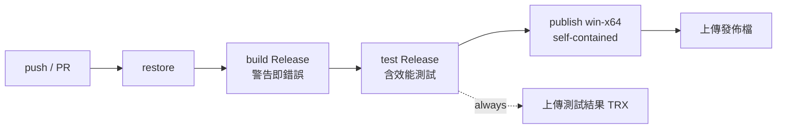

# 第 9 章　建置、CI 與發佈

> 本章目標：了解如何用幾個集中設定檔讓所有專案遵守相同規則；如何用 GitHub Actions 在每次 push 時自動建置、測試、打包；以及如何發佈一個使用者免安裝 .NET 的桌面程式。另外說明這個專案的開發節奏（里程碑與 commit）。

---

## 9.1 集中的建置設定

### `global.json`：固定 SDK 版本

```json
{ "sdk": { "rollForward": "latestFeature", "version": "9.0.315" } }
```

所有開發者與 CI 都用相同的 SDK 主要版本建置，避免「我這邊可以編譯」的問題。

### `Directory.Build.props`：所有專案共用的編譯選項

```xml
<Project>
  <PropertyGroup>
    <LangVersion>latest</LangVersion>
    <Nullable>enable</Nullable>                      <!-- 開啟可為 null 參考型別檢查 -->
    <ImplicitUsings>enable</ImplicitUsings>
    <TreatWarningsAsErrors>true</TreatWarningsAsErrors>   <!-- 警告一律視為錯誤 -->
    <AnalysisLevel>latest</AnalysisLevel>            <!-- 最新的程式碼分析規則 -->
    <EnforceCodeStyleInBuild>true</EnforceCodeStyleInBuild>
    <Deterministic>true</Deterministic>              <!-- 相同原始碼產生相同的組件 -->
    <IsPackable>false</IsPackable>
    <SatelliteResourceLanguages>en;zh-Hant</SatelliteResourceLanguages>   <!-- 發佈檔只帶需要的語系資源 -->
  </PropertyGroup>
</Project>
```

MSBuild 會自動套用專案目錄往上找到的第一個 `Directory.Build.props`，所以 8 個專案（src 4、tests 3、tools 1）不用各自設定。

**`TreatWarningsAsErrors` 的意義**：警告如果允許存在，很快就會累積到幾百個，真正重要的警告被淹沒。一開始就設成錯誤，警告數永遠是 0。搭配 `Nullable`，大部分 `NullReferenceException` 在編譯時就被擋下。

### `Directory.Packages.props`：集中管理套件版本

```xml
<Project>
  <PropertyGroup>
    <ManagePackageVersionsCentrally>true</ManagePackageVersionsCentrally>
  </PropertyGroup>
  <ItemGroup>
    <PackageVersion Include="Microsoft.Data.Sqlite" Version="9.0.21" />
    <PackageVersion Include="Microsoft.AspNetCore.Components.Web" Version="9.0.21" />
    <PackageVersion Include="Microsoft.AspNetCore.Components.WebView.WindowsForms" Version="9.0.120" />
    <PackageVersion Include="xunit" Version="2.9.3" />
    <PackageVersion Include="bunit" Version="2.12.5" />
    <!-- ... -->
  </ItemGroup>
</Project>
```

這叫 **Central Package Management（CPM）**。各專案的 `.csproj` 只寫 `<PackageReference Include="Microsoft.Data.Sqlite" />`，不寫版本。好處：所有專案保證用同一個版本；升級時只改一個地方。

### `.gitattributes`：固定換行字元

```
*.cs     text eol=crlf
*.yml    text eol=lf
*.tourney binary
```

避免不同作業系統的開發者把整個檔案的換行字元改掉，造成無意義的 diff。

### 一個建置上的小坑

```xml
<!-- src/TourneyDesk.App/TourneyDesk.App.csproj -->
<!-- WebView2 套件會無條件加入 WPF 控制項組件；本專案不使用 WPF，移除以避免 WindowsBase 版本衝突 -->
<Target Name="RemoveWebView2WpfReference" BeforeTargets="ResolveAssemblyReferences">
  <ItemGroup>
    <Reference Remove="@(Reference)" Condition="'%(Filename)' == 'Microsoft.Web.WebView2.Wpf'" />
  </ItemGroup>
</Target>
```

套件有時會帶進你不需要的東西。因為警告視為錯誤，這個版本衝突警告會讓建置失敗，於是用一個 MSBuild target 在解析參考前把它移除，並在註解說明原因。

---

## 9.2 CI：GitHub Actions

```yaml
# .github/workflows/ci.yml
name: CI
on:
  push:
    branches: [ main ]
  pull_request:
  workflow_dispatch:

jobs:
  build-test-publish:
    runs-on: windows-latest            # UI 需要 Windows（WinForms、WebView2）
    env:
      TOURNEYDESK_PERF_FACTOR: 2       # 雲端 runner 較慢，效能門檻放寬 2 倍
    steps:
      - uses: actions/checkout@v4
      - uses: actions/setup-dotnet@v4
        with: { dotnet-version: 9.0.x }
      - run: dotnet restore TourneyDesk.sln
      - run: dotnet build TourneyDesk.sln -c Release --no-restore
      - run: dotnet test TourneyDesk.sln -c Release --no-build --logger "trx;LogFilePrefix=results" --results-directory TestResults
      - uses: actions/upload-artifact@v4          # 即使測試失敗也上傳結果，方便查看
        if: always()
        with: { name: test-results, path: TestResults }
      - run: dotnet publish src/TourneyDesk.App/TourneyDesk.App.csproj -c Release -r win-x64 --self-contained true -o publish/win-x64
      - uses: actions/upload-artifact@v4
        with: { name: TourneyDesk-win-x64, path: publish/win-x64 }
```

流程：



設計重點：

- **用 Release 組態測試**：效能測試只在 Release 執行（第 8 章），而且這才是使用者實際執行的版本。
- **`--no-restore`、`--no-build`**：每一步只做自己的事，失敗時一眼看出是哪個階段。
- **`if: always()` 上傳測試結果**：測試失敗時更需要看結果檔。
- **發佈檔作為 artifact**：每次 commit 都有一個可下載、可直接執行的版本。

README 頂端放 CI 徽章，一眼看出目前主分支是否綠燈。

---

## 9.3 發佈：self-contained

```powershell
dotnet publish src/TourneyDesk.App/TourneyDesk.App.csproj -c Release -r win-x64 --self-contained true -o publish/win-x64
```

| 方式 | 使用者需要 | 大小 |
|---|---|---|
| framework-dependent | 先安裝 .NET 9 Desktop Runtime | 小 |
| **self-contained（本專案）** | 什麼都不用裝（只需 WebView2，Windows 11 內建） | 約 112 MB（壓縮後約 48 MB） |

社團總幹事的電腦不一定裝了 .NET 9，也不一定有權限或意願另外安裝，所以選 self-contained（決策 Q6）：整個資料夾複製過去就能執行。

WebView2 Runtime 在 Windows 11 與大多數更新過的 Windows 10 上都已內建；萬一沒有，程式啟動時會偵測並顯示安裝說明，而不是直接當掉（第 7 章）。這個情境用環境變數 `WEBVIEW2_BROWSER_EXECUTABLE_FOLDER` 指向不存在的路徑來實機驗證。

---

## 9.4 開發節奏：里程碑與 commit

這個專案依 `docs/design.md` 第 13 節的里程碑開發，每個里程碑都能編譯、能測試，完成就 commit：

| 里程碑 | 內容 |
|---|---|
| M0 | Solution 骨架、架構約束測試、CI |
| M1 | 領域模型、Session、復原堆疊、狀態雜湊 |
| M2 | 排名與同分判定 |
| M3 | 瑞士制配對引擎與參考解驗證 |
| M4 | 瑞士制流程命令、過期判定、退賽與遲到加入 |
| M5 | 循環賽排程 |
| M6 | 單淘汰籤表、連鎖清除、復原性質測試 |
| M7 | SQLite 賽事檔、schema 版本、開檔鎖定、自動備份 |
| M8 | CSV 選手匯入 |
| M9 | 籤表與交叉表的版面計算與分頁 |
| M10 | Blazor Hybrid 介面、列印與匯出 |
| M11 | 範例資料、產生工具、README |

觀察這個順序：

- **M0 就有 CI 與架構測試**：從第一天起就有自動檢查，而不是最後才補。
- **先 Core、後 Data、最後 UI**：UI 是最容易變動的部分，等規則穩定後再做，返工最少。
- **最難的瑞士制引擎（M3）排在前面**：風險最高的部分越早做，越早知道可不可行。
- **復原性質測試在 M6**：等所有命令都存在後，才能寫「涵蓋所有命令種類」的隨機測試。

### Commit message 寫「為什麼」

```
fix(data): 當機留下的熱日誌不再讓賽事檔打不開
perf(core): 過期判定以各輪輸入指紋快取引擎建議，只重算輸入有變的輪次
fix(core): 正常退賽不再讓已發布輪次被誤判為「過期」
```

採用 Conventional Commits 格式（`feat`、`fix`、`perf`、`test`、`docs`、`chore`），標題說明「改了什麼行為」，內文說明原因與做法。半年後用 `git log` 就能回答「這段程式為什麼長這樣」。

### 產生測試資料的工具

400 人的測試賽事檔太大，不提交到 repo，改用工具產生：

```powershell
dotnet run --project tools/TourneyDesk.SampleGen -c Release -- players400 400人.tourney --rounds 9
dotnet run --project tools/TourneyDesk.SampleGen -c Release -- players400-csv 400人.csv
dotnet run --project tools/TourneyDesk.SampleGen -c Release -- demo 示範資料夾
```

「可重現的產生方式」比「提交一個大檔案」更好：檔案格式升級時重新產生即可，repo 也保持精簡。

---

## 9.5 本章小結

1. `global.json`、`Directory.Build.props`、`Directory.Packages.props` 集中管理 SDK、編譯選項與套件版本。
2. 警告視為錯誤，從第一天保持 0 警告。
3. CI 在 Windows 上以 Release 建置、測試、發佈，並上傳測試結果與可執行檔。
4. self-contained 發佈讓使用者免安裝 .NET。
5. 依里程碑小步前進：先建 CI 與架構測試，先做風險最高的部分，UI 最後做。

下一章：從真實的 bug 學習，並動手延伸系統。→ [第 10 章　案例研究與練習](10-case-studies-and-exercises.md)
